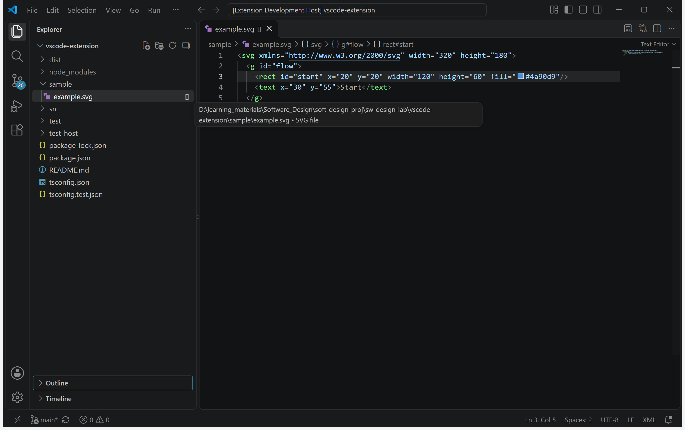
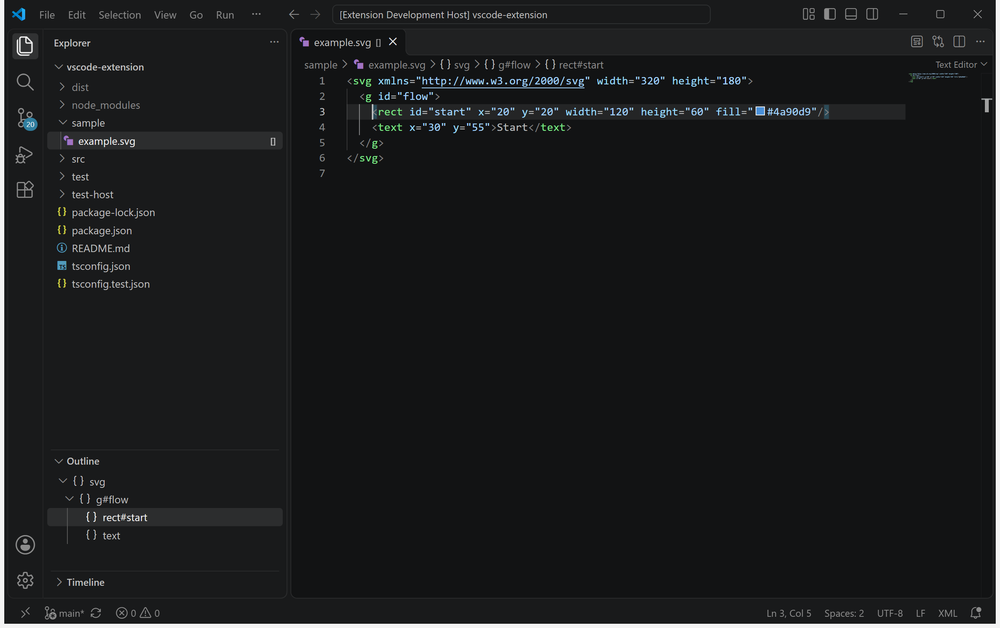

# Lab1 Phase 2：插件实践与插件式重构

## 1. 实验范围与基线

本阶段包含两项任务：使用 VSCode 扩展 API 为 SVG 文件提供 Explorer 标记和原生 Outline；将 Phase 1 SVG CLI 重构为具有图形、命令、树标签和属性语义四个扩展点的插件式框架，并实现 `stats`、`dir`、`box`、`modified-star` 与 `(box)` 标签。

Phase 1 的完整报告、源码和运行证据保存在不可移动的 `final` 标签。本文只保留理解重构所需的基线：当时 `src/model`、`src/editor`、`src/svg`、`src/cli` 分别承担领域、会话、持久化和命令行职责，具体图形创建和命令分派仍是封闭集合。重构前的源码依赖图见 [Phase 1 PlantUML](assets/architecture.plantuml)。Phase 2 继续以 Phase 1 的命令、输出和失败状态为兼容边界；两份 `final` 会话及保存 SVG 由自动测试逐字节比较。

## 2. VSCode 插件实践

### 2.1 功能、启动与验证

扩展源码位于 `vscode-extension/`。在该目录执行：

```powershell
npm ci --cache ../.npm-cache
npm test
npm run typecheck
npm run build
code --extensionDevelopmentPath="$PWD" --disable-extensions `
  --user-data-dir="$PWD/../tmp/vscode-ui-user" `
  --extensions-dir="$PWD/../tmp/vscode-ui-extensions" "$PWD"
```

在隔离的 Extension Development Host 中以文本编辑器打开 `sample/example.svg`。扩展为普通 `.svg` 文件返回 `[]` 标记，不修改文件名或内容；目录和非 SVG 文件无标记。Document Symbol Provider 把 SVG 元素映射为嵌套的原生 Outline：有 id 时显示 `tag#id`，无 id 时显示 `tag`，选择节点可定位源码范围。XML 暂时不完整时返回空符号数组，不使扩展崩溃。





截图于 2026-11-23 在 VSCode 1.147.0 x64 的隔离宿主中取得，使用 `--disable-extensions` 禁用其他扩展并关闭 Git 装饰。隔离基线显示未加载本扩展时 SVG 文档没有符号，见[基线截图](phase2/images/vscode-baseline-outline.png)。磁盘内容改变后的 Outline 更新、不完整 XML 及恢复已实际观察；编辑器内直接输入后的可见刷新无法在本会话可靠观察，仍标为待人工验证。宿主测试已验证 `WorkspaceEdit` 后文档符号会更新。

### 2.2 VSCode、插件与设计模式

VSCode 拥有 Explorer、Outline、生命周期和回调调度；扩展的 `activate` 只注册 `FileDecorationProvider` 与 `DocumentSymbolProvider`。VSCode 在渲染资源或请求当前文档符号时调用提供者，插件返回 UI 元数据和带源码范围的符号树。

文件装饰比较过修改文件名/自建 Explorer 与使用 File Decoration API，选择后者，因为它只附加显示元数据，不拥有文件。它与经典 Decorator 都增加表现信息，但不是 GoF Decorator：没有以同一接口包装文件对象，也没有逐层委托链。两个提供者把 URI、文件类型和 XML 文本转换为 VSCode 的 `FileDecoration`、`DocumentSymbol` 契约，具有 Adapter 的接口转换作用。

Outline 比较过自建 `TreeView` 与 `DocumentSymbolProvider`，选择后者以复用原生层级、定位和刷新协议。解析没有复用 Phase 1 `SvgCodec`：CLI 编解码器会执行 SVG 子集校验、生成缺失 id，且不保留源码范围；扩展需要容忍更宽的 SVG 输入并精确定位，因此使用轻量源码投影。若未来 CLI 也需要源码范围，再评估共享解析边界。

## 3. Phase 2 CLI 架构

### 3.1 模块与依赖方向

| 区域     | 路径            | 职责与边界                                                             |
| -------- | --------------- | ---------------------------------------------------------------------- |
| 内核     | `src/core/`     | 文档、图形抽象、编辑历史及四种扩展契约；不导入宿主、适配器或具体插件。 |
| 宿主     | `src/host/`     | CLI 协议、组合根、插件安装和配置加载；把实现注入内核契约。             |
| 技术适配 | `src/adapters/` | SVG/XML 与文件边界；不拥有编辑历史或插件选择策略。                     |
| 内置实现 | `src/builtin/`  | 六种 Phase 1 图形及提供者；仅依赖内核公开面。                          |
| 可选插件 | `plugins/`      | `box`、`stats`、`dir`、`modified-star`；不依赖内核内部或宿主。         |

重构比较了“保留旧工厂，只给新类型使用注册表”和“内置与可选类型统一注册”两种方案。前者迁移少，却要求调用方同时理解中央分支和插件分派；最终采用后者，使创建、SVG 读回和禁用只有一条选择路径。命令同样由内置实现与插件共用 `CommandRegistry`，没有在旧分派末尾增加第二套查询。

重构后的源码依赖图见 [Phase 2 PlantUML](phase2/architecture-after.plantuml)。图中箭头表示源码导入而非运行时回调；主要方向为 `host → core`、`adapters → core`、`builtin/plugins → core public API`。`scripts/check-dependencies.mjs` 及其反例测试持续约束这些方向，并拒绝已经迁出的旧目录。

### 3.2 四个扩展点清单

| 扩展点             | 接口职责                                    | 内核调用位置                                                                             | 已有实现                                    | 禁用可选插件时                                                   | 违反契约时                                                                        |
| ------------------ | ------------------------------------------- | ---------------------------------------------------------------------------------------- | ------------------------------------------- | ---------------------------------------------------------------- | --------------------------------------------------------------------------------- |
| `ShapeProvider`    | 按类型创建分离图形，可选地读回中性 SVG 节点 | `EditorSession.create` → `ShapeProviderRegistry.create`；`SvgCodec.decode` → `readSvg`   | 六种内置提供者、`BoxShapeProvider`          | 仍提供 `g/rect/circle/ellipse/line/text`；box 标记降级为普通 `g` | 重名、未知类型、缺少读回方法、非图形结果或错误 id 均拒绝；文档接入前再校验整树 id |
| `Command`          | 提供名称、帮助文本和一次外部命令执行        | `CliApp.runLine` → `CommandRegistry.execute`                                             | 内置命令、`StatsCommand`、`DirCommand`      | 内置命令正常；未装命令返回 `error: unknown command: <name>`      | 重名拒绝；`EditorError` 统一转为 `error:`；失败不进入编辑历史                     |
| `TreeDecorator`    | 为语义树行贡献可选后缀并拥有自身基线        | `TreeFormatter` → `TreeDecoratorRegistry.labels`；成功 init/read/save 后 `resetBaseline` | `ModifiedStarDecorator`、`BoxTypeDecorator` | 空注册表无后缀，Phase 1 `tree` 逐字节不变                        | 重名以及空白或含换行的标签拒绝；其余标签按注册顺序组合                            |
| `AttributeHandler` | 选择特定图形/属性并准备可逆修改计划         | `SvgDocument.set` → `AttributeHandlerRegistry.prepare`                                   | `BoxAttributeHandler` 的 `fill`、`label`    | 无匹配时使用 Phase 1 图形属性规则                                | 重名或多重匹配拒绝；已匹配失败不回退；部分应用失败回滚且不改变历史                |

接口由内核拥有，具体实现只通过构造注入或 `PluginContext` 进入系统。插件上下文仅暴露四个注册函数与延迟只读 `tree()`，不提供可变文档或装配器内部状态。`PluginInstaller.install` 为每个插件建立私有暂存区，核对清单后才一次公布，避免失败后残留部分注册。

## 4. 插件能力与模式协作

### 4.1 `stats`、`dir` 与 Adapter

`StatsCommand` 只读取语义 `TreeView`，按画布顺序深度优先统计叶子和容器，不解析显示标签，也不访问可变文档。`DirCommand` 依赖插件自己拥有的 `DirectoryReader` Target；`NodeDirectoryReader` 是 Adapter，把 `process.cwd()` 和 `fs.readdirSync` 的 `Dirent` 转为 `directory/file/other` 中性条目。命令负责过滤、排序和题目文本，适配器不泄漏平台异常文本。

特殊目录项比较了“跟随符号链接按目标归类”和“按目录项自身类型归类并忽略特殊项”。采用后者，避免访问当前目录之外的目标并使结果依赖额外权限。目录先于文件，各组按名称升序；隐藏项照常显示，符号链接等 `other` 不显示。替身测试覆盖混合项、空目录、隐藏项、失败和稳定排序，临时目录测试覆盖真实 Node 适配器。详细决策见 [ADR-008](adr/ADR-008-dir-adapter-and-special-entries.md)。

### 4.2 `box`、属性事务与读回

`BoxShape` 是包含必要矩形和文字的 Composite 容器。`BoxShapeProvider` 通过公开创建上下文取得内置 `rect`、`text`，不导入其具体类；整棵候选树通过文档 id 校验后一次接入。必要子部件不能被普通删除、移走或解组，额外内容仍可嵌套。

`BoxAttributeHandler` 不直接管理历史，而是返回可应用、撤销和重做的修改计划。文档统一应用计划并签发一个回执，因此一次 `set` 保持一个 undo 单元；应用中途失败时按同一计划回滚。SVG 中 `data-kind="box"` 在插件存在时分派给 box 读回器，结构异常明确拒绝；插件缺失时去掉语义标记并按普通 `g` 读回。相关边界见 [ADR-009](adr/ADR-009-attribute-handler-contract.md)与 [ADR-011](adr/ADR-011-box-read-and-structure-protection.md)。

### 4.3 树标签

树格式化器只负责枝线和主体文本，`TreeDecorator` 贡献语义后缀。`ModifiedStarDecorator` 以实例字段保存基线指纹，叶子变化传播到祖先；成功 init/read/save 后更新基线。`BoxTypeDecorator` 只读取稳定的 `ShapeView.kind`，不依赖 `BoxShape` 或解析标签文本。两个插件按注册顺序组合为 `* (box)`，互不感知；禁用后恢复 Phase 1 输出。dirty 与祖先传播决策见 [ADR-010](adr/ADR-010-tree-decoration-and-dirty-semantics.md)。

## 5. 两种装配方式

代码方式由 `createCodeApplication` 调用 `installCodePlugins`；新增插件的唯一选择点是 `src/host/assembly/CodePlugins.ts`。配置方式由 `createConfiguredApplication` 调用 `PluginLoader`，已有运行源码不需要认识插件名称。两种方式进入同一个 `PluginInstaller`，最后由 `ApplicationAssembly.build` 构造注册表、会话、SVG 适配器和 CLI。

配置文件格式如下；数组顺序即安装顺序，`enabled: false` 完全跳过，相对模块路径以配置文件目录为基准，`options` 原样传给插件：

```json
{
  "plugins": [
    { "module": "./plugins/box/index.ts" },
    { "module": "./plugins/stats/index.ts" },
    { "module": "./plugins/dir/index.ts" },
    { "module": "./plugins/modified-star/index.ts", "enabled": false }
  ]
}
```

插件 `package.json` 用 `contributes.shapes/commands/decorators/attributes` 声明稳定注册名。模块不存在、无默认导出、清单不符、激活异常或重复注册均转换为题目规定的错误；当前插件被丢弃，先前成功插件保留，并继续后续项。非法配置报告 `error: invalid plugin config`，然后仅以默认内置能力启动。事务决策见 [ADR-012](adr/ADR-012-plugin-installation-transaction.md)。

在插件集合、顺序、输入、初始文件和固定工作目录一致时，两份 Phase 1 会话、box 会话以及 stats/dir 会话的代码/配置装配 stdout 已逐字节比较。历史接入提交的路径差异判据仍存在缺口，见第 7 节，不能由当前目录结构或运行一致性替代。

## 6. 验证与可复现证据

仓库根目录的常规门禁为：

```powershell
npm test
npm run typecheck
npm run lint
npm run format:check
npm run deps:check
npm run tracked:check
```

当前全量测试为 404 项，覆盖四扩展点契约、插件独立行为、属性失败回滚、box 读回与结构保护、加载失败隔离、真实文件系统 Adapter、真实 CLI 进程、双装配一致性以及 Phase 1 输出和保存 SVG 的逐字节基线。验证场景与状态详见 [Phase 2 验收矩阵](phase2/requirements.md)。

指标由 `scripts/generate-metrics.mjs` 直接读取 Git 对象，按内核、装配、插件和 VSCode 分类统计物理行数与基于 TypeScript AST 的圈复杂度。默认比较 `final` 与 `p2`；`p2` 尚未创建，因此当前只验证了 `final→HEAD` 的脚本可复现性，没有提交伪造的最终指标。

## 7. 过程决策、AI 复核与未决项

本阶段的架构选择分别记录在 [ADR-005 至 ADR-012](adr/)；其中属性事务、读回降级、dirty 语义和配置清单校验均有独立 ADR。开发按“先缺陷测试、再最小实现、最后全量回归”推进。一次重要纠偏发生在报告预审：架构图把领域模型归入 `src/core/model`，但 `SvgDocument` 仍留在旧 `src/model`。没有在报告中解释不一致，而是先加依赖反例，再完成纯路径迁移并删除旧目录规则，使代码、依赖检查、指标分类和本文一致。

截至当前，功能和自动化证据基本齐备，但仍不能宣称 Phase 2 完成交付：

- 方式 A/B 的历史插件接入提交没有完整满足题目要求的两条 `git diff` 范围证据；当前边界合规不能追溯替代该证据。
- VSCode 编辑器内直接输入后的 Outline 可见刷新仍待人工复核；只能报告宿主测试和已观察到的磁盘变更结果。
- 最终指标必须在最终提交和 `p2` 存在后生成。
- 远端核对、最终提交和 `p2` 标签均尚未执行。

这些限制也保留在 [Phase 2 验收矩阵](phase2/requirements.md)，避免以报告文字覆盖尚未取得的证据。
