# Lab1 Phase 2 实验报告：VSCode 插件实践与 SVG CLI 插件式重构

## 1. 实验目标与完成结果

本实验包含两个相互独立又共同体现扩展机制的任务：一是在 VSCode 中为 SVG 文件提供 Explorer 标记与原生 Outline；二是在保持 Phase 1 行为不变的前提下，将 SVG CLI 重构为可通过图形、命令、树标签和属性处理器扩展的插件式框架。

实现结果如下：

- VSCode 扩展通过 `FileDecorationProvider` 为普通 `.svg` 文件显示 `[]`，通过 `DocumentSymbolProvider` 提供嵌套 Outline、源码定位、编辑更新和不完整 XML 容错。
- CLI 内核开放 `ShapeProvider`、`Command`、`TreeDecorator`、`AttributeHandler` 四个扩展点，并提供内置实现、注册表、缺省行为和契约校验。
- 可选插件实现了 `stats`、`dir`、`box`、`modified-star` 与 `(box)` 标签；`dir` 通过文件系统 Adapter 工作。
- 选做扩展 `diamond` 复用同一图形提供者与 Composite 契约接入内核，在不修改内核分支的情况下支持创建、编辑、序列化和语义读回。
- 同一插件既可由代码组合根装入，也可由 JSON 配置动态装入；两种方式共用安装、清单校验、注册和应用构建路径。
- Phase 1 的两份完整会话、标准输出和保存 SVG 均与 `final` 标签逐字节一致。

**结论：Phase 2 的全部必做功能、四个扩展点、双装配路径和兼容性要求均已实现，并由自动测试、真实进程输出、Git 差异及 VSCode 人工截图共同验证。**

Phase 1 的完整源码和报告保存在不可移动的 `final` 标签。本文仅说明 Phase 2 所需的基线、重构设计、实现结果与验证证据。

## 2. 环境与运行方法

CLI 要求 Node.js `^22.20.0` 或 `>=24.12.0`。在仓库根目录执行：

```powershell
npm ci
npm run cli
```

使用配置装配时执行：

```powershell
npx tsx src/main.ts --config plugins.config.json
```

VSCode 扩展位于 `vscode-extension/`，可按以下方式启动隔离的 Extension Development Host：

```powershell
cd vscode-extension
npm ci --cache ../.npm-cache
npm test
npm run typecheck
npm run build
code --extensionDevelopmentPath="$PWD" --disable-extensions `
  --user-data-dir="$PWD/../tmp/vscode-ui-user" `
  --extensions-dir="$PWD/../tmp/vscode-ui-extensions" "$PWD"
```

VSCode 可能默认以图像预览打开 SVG。人工验收前，应在编辑器标签的 **Reopen Editor With... → Configure default editor for `*.svg`...** 中选择 **Text Editor**，关闭并重新打开 `sample/example.svg`。图片预览不提供文本源码，不能用于 Outline 定位验收。

## 3. VSCode 插件实践

### 3.1 文件标记与原生 Outline

扩展只对本地普通 `.svg` 文件返回 `[]` 文件装饰，不修改文件名、文件内容或目录。`DocumentSymbolProvider` 将 SVG 元素投影为嵌套符号：节点至少显示标签名，存在 `id` 时显示 `tag#id`；符号的 `range` 覆盖元素，`selectionRange` 指向开始标签，因此选择 Outline 节点可以定位源码。

解析器对每个编辑器快照独立工作。XML 暂时不完整时返回空符号数组，不抛出错误或保留过期结构；恢复为完整 XML 后，VSCode 再次请求符号并更新 Outline。

扩展的 8 项单元测试覆盖 `.svg`/非 SVG/目录筛选、嵌套分组、无 id 元素、源码范围、编辑更新和不完整 XML；隔离宿主测试及实际界面进一步验证了原生 Outline 的层级、点击定位与可见刷新。


_图 1　`example.svg` 显示 `[]`，悬停提示仍表明它是原路径下的 SVG 文件。_


_图 2　原生 Outline 显示 `svg → g#flow → rect#start/text`，选择 `rect#start` 后定位到对应开始标签。_

以上截图取自 VSCode 1.147.0 x64 的隔离宿主，其他扩展和 Git 装饰均已禁用。文件标记的[完整宿主画面](phase2/images/vscode-svg-badge.png)保留了窗口上下文；未加载本扩展时，同一环境没有 SVG 文档符号，见[基线截图](phase2/images/vscode-baseline-outline.png)。


_图 3　在未保存的文本编辑器中把 `id="start"` 改为 `id="changed"` 后，源码、Breadcrumb 与 Outline 同步显示 `rect#changed`。_

### 3.2 VSCode 与扩展的职责

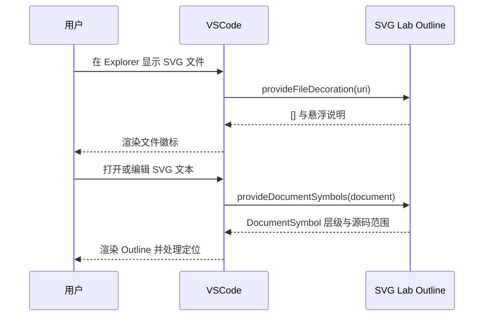

VSCode 拥有 Explorer、Outline、文本编辑器、生命周期和回调调度；扩展只注册两个 Provider，并把 URI 或文档文本转换为 VSCode 契约。扩展不创建替代界面，也不主动控制符号的点击行为。

文件装饰与经典 Decorator 都能增加表现信息，但这里不是 GoF Decorator：扩展没有以相同接口包装文件对象，也不存在逐层委托的包装链。两个 Provider 更接近 Adapter，它们把文件状态和 XML 文本转换为 `FileDecoration`、`DocumentSymbol`，而界面所有权仍属于 VSCode。

Outline 采用 `DocumentSymbolProvider` 而非自建 `TreeView`，从而直接复用原生层级、定位和刷新协议。解析没有复用 CLI 的 `SvgCodec`：`SvgCodec` 面向受限 SVG 子集，会执行领域校验并为缺失 id 的元素分配 id，但不保留源码位置；编辑器扩展需要容忍更宽的 SVG 内容并精确映射字符偏移。两者共享的是 SVG 树这一概念，不共享具有不同约束的解析实现。

## 4. CLI 架构与依赖方向

### 4.1 重构前后对比

Phase 1 由 `src/cli`、`src/editor`、`src/model` 和 `src/svg` 构成，具体图形创建和命令分派仍是封闭集合。原始 PlantUML 见[重构前架构图](assets/architecture.plantuml)。

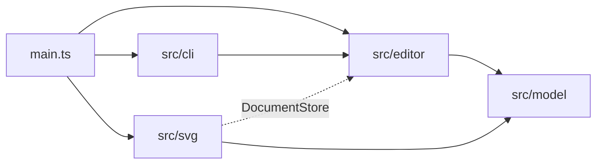

Phase 2 按隐藏的设计知识划分内核、宿主、适配器、内置实现和可选插件。完整 PlantUML 见[重构后架构图](phase2/architecture-after.plantuml)。

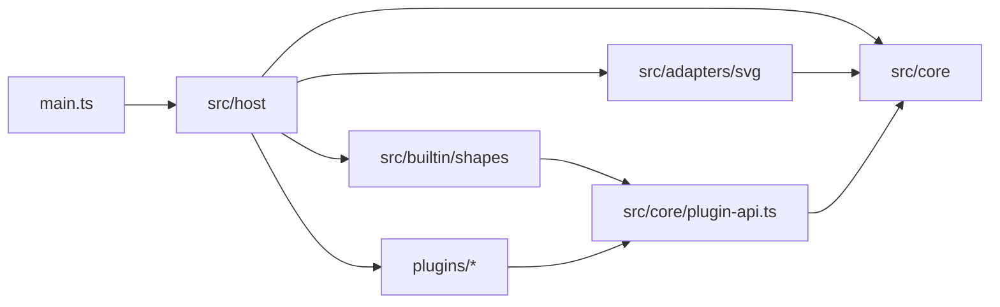

| 区域       | 路径            | 主要职责                                                                       |
| ---------- | --------------- | ------------------------------------------------------------------------------ |
| 内核       | `src/core/`     | 文档与图形规则、编辑历史、四种扩展契约和注册表；不导入宿主、适配器或插件实现。 |
| 宿主       | `src/host/`     | CLI 协议、应用装配、插件安装和配置加载。                                       |
| 技术适配器 | `src/adapters/` | SVG/XML 与磁盘 I/O；不决定安装哪些插件。                                       |
| 内置实现   | `src/builtin/`  | Phase 1 六种图形及其提供者。                                                   |
| 可选插件   | `plugins/`      | `box`、`diamond`、`stats`、`dir`、`modified-star` 等独立能力。                 |

重构没有保留“旧工厂负责内置类型、注册表只负责新类型”的双分派。所有图形均通过 `ShapeProviderRegistry` 创建和读回，所有命令均通过 `CommandRegistry` 分派，调用方不需要同时理解封闭分支和插件查询。`scripts/check-dependencies.mjs` 对实际导入方向进行机械检查，并以反例测试拒绝内核反向依赖、插件越过公开入口和宿主硬编码插件等情况。

### 4.2 四个扩展点

| 扩展点             | 职责                                        | 内核调用位置                                                         | 已有实现                                    | 禁用可选插件时                                                | 契约失败处理                                                                   |
| ------------------ | ------------------------------------------- | -------------------------------------------------------------------- | ------------------------------------------- | ------------------------------------------------------------- | ------------------------------------------------------------------------------ |
| `ShapeProvider`    | 按类型创建分离图形，并可从中性 SVG 节点读回 | `EditorSession.create`、`SvgCodec.decode` 经 `ShapeProviderRegistry` | 六种内置提供者、box 与 diamond 提供者       | 六种 Phase 1 图形仍可用；语义组合图形按普通 `g` 读回          | 重名、未知类型、缺少读回器、错误对象或根 id 不符均拒绝；文档接入前校验整棵子树 |
| `Command`          | 提供命令名、帮助文本和执行逻辑              | `CliApp.runLine` 经 `CommandRegistry.execute`                        | 内置命令、`StatsCommand`、`DirCommand`      | 内置命令正常；未安装命令返回 `error: unknown command: <name>` | 重名拒绝；领域错误统一显示为 `error:`，失败不进入编辑历史                      |
| `TreeDecorator`    | 为语义树行追加独立标签并维护自身状态        | `TreeFormatter` 经 `TreeDecoratorRegistry.labels`                    | `ModifiedStarDecorator`、`BoxTypeDecorator` | 不追加标签，Phase 1 `tree` 输出逐字节不变                     | 重名、空白或含换行的标签拒绝；有效标签按注册顺序组合                           |
| `AttributeHandler` | 为特定图形和属性准备可逆修改计划            | `SvgDocument.set` 经 `AttributeHandlerRegistry.prepare`              | `BoxAttributeHandler`                       | 无匹配时使用 Phase 1 属性规则                                 | 多重匹配拒绝；已匹配失败不回退；部分应用失败会回滚且不改变历史                 |

四个接口由内核拥有，插件只依赖 `src/core/plugin-api.ts` 暴露的公开抽象。`PluginContext` 只提供四个注册函数和延迟只读 `tree()`，不暴露可变文档、编辑会话或装配内部状态。

## 5. 插件实现与模式协作

### 5.1 `stats` 与 `dir`

`StatsCommand` 读取语义树，按照画布子节点顺序深度优先遍历。叶子类型按首次出现顺序统计，普通 `g` 和 `box` 只计入容器数，box 内部叶子照常计入 total，根 SVG 不计；命令不修改文档和历史。

<p align="center">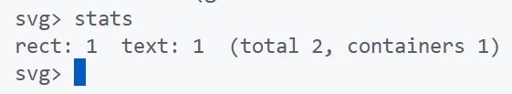</p>

_图 4　`stats` 按首次出现顺序统计当前文档的叶子图形，并单独给出容器数。_

空文档精确输出 `(total 0, containers 0)`。插件启用时 `help` 包含 `stats`，禁用时执行该名称精确输出 `error: unknown command: stats`；两种路径都不会写入 undo/redo 历史。

`DirCommand` 使用 Adapter 访问真实文件系统：

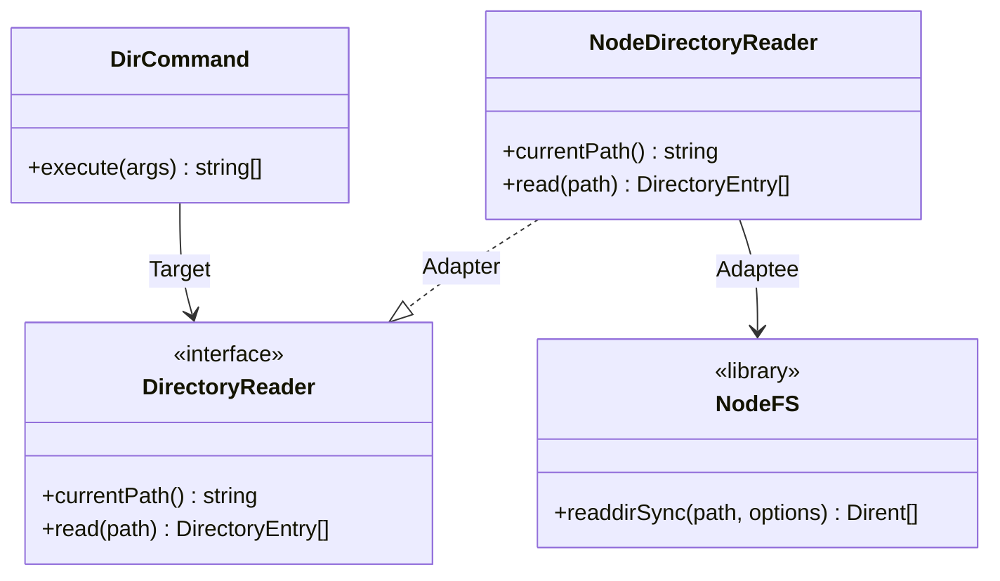

`DirectoryReader` 是插件拥有的 Target，`NodeDirectoryReader` 将 `process.cwd()` 和 Node `Dirent` 转换为中性目录项。命令负责题目规定的过滤、分组、排序和输出，适配器负责隔离平台 API 与异常。符号链接等特殊项不跟随目标并作为 `other` 忽略，避免访问当前目录之外的对象。该选择记录于 [ADR-008](adr/ADR-008-dir-adapter-and-special-entries.md)。

`dir` 不接收参数，也不依赖 SVG 文档；未执行 `init` 或 `read` 时仍可使用。它只列出 CLI 进程当前工作目录的直接子项，`read`/`save` 不会把工作目录切换为 SVG 所在目录。目录在前、文件在后，各组按名称升序，隐藏项正常显示，标记与名称之间保留两个空格。空目录输出 `(empty directory)`；读取失败输出 `error: cannot read directory: <path>`，随后仍可继续执行命令。成功或失败均不改变文档、dirty、工作目录或 undo/redo 历史。启用时 `help` 包含 `dir`，禁用时精确输出 `error: unknown command: dir`。

命令逻辑通过 `DirectoryReader` 替身覆盖混合项、空目录、隐藏项、失败和稳定排序，并使用临时目录验证同一个 `DirCommand` 与真实 `NodeDirectoryReader` 的组合；代码装配与配置装配在固定目录上的输出逐字节一致。

### 5.2 `box`、Composite 与属性事务

`BoxShape` 是 Composite 容器，必要子节点为 `<id>-rect` 和 `<id>-label`，默认框体填充为 `#4a90d9`，其后仍可包含其他图形。它支持 `in` 子句、整体移动、删除、缩放、嵌套及 undo/redo；`ungroup` 精确拒绝为 `error: cannot ungroup composite shape: <id>`。`BoxShapeProvider` 通过公开创建上下文请求内置 `rect`、`text`，不导入具体实现；完整候选树经过环、对象身份和全局 id 唯一性检查后一次接入，任一派生 id 冲突都会使整条创建命令原子失败。普通命令不能删除、移走或重新分组必要子节点，从而保持结构不变量。

<p align="center">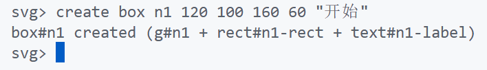</p>

_图 5　创建 `box#n1` 时，CLI 在一条结果中列出复合根及两个必要子节点。_

`BoxAttributeHandler` 为 `fill` 和 `label` 返回可应用、撤销和重做的 `PreparedSet`：前者修改内部矩形，后者修改内部文字。文档统一执行计划并签发一个回执，因此一次 `set` 始终对应一个 undo 单元，可由一次 `undo`/`redo` 整体恢复或重做。无处理器命中时沿用 Phase 1 属性白名单；一个处理器命中后失败不回退；多个处理器命中时在修改前拒绝并列出冲突处理器。应用途中抛错时，已执行步骤按逆序回滚，文档与 undo/redo 历史保持不变。契约见 [ADR-009](adr/ADR-009-attribute-handler-contract.md)。

序列化后的 box 使用 `<g data-kind="box">`。安装插件时，读回器严格检查必要子节点的类型、派生 id 和顺序；结构异常、重复 id 或非法子树会拒绝整次读取，并保留读入前的会话。未安装 box 插件时，语义标记被去除并按普通 `g` 读取，完整可见子树与顺序仍保留。插件独立测试使用公开创建上下文替身，Phase 1 §6.1 的 box 会话也已完整复现。读回与保护规则见 [ADR-011](adr/ADR-011-box-read-and-structure-protection.md)。

### 5.3 相互独立的树标签

`TreeFormatter` 只负责遍历、枝线、列对齐和主体文本。每个 `TreeDecorator` 接收只读的画布或图形语义视图，只返回该行的可选标签；注册表按安装顺序收集标签，再由格式器统一追加。因此插件无需解析已经排版的字符串，也不必了解其他标签。这里的装饰是独立附加行尾信息，并非经典 GoF Decorator 对格式器的逐层包装。

`BoxTypeDecorator` 仅查看图形视图的语义 `kind`：box 根节点显示 `(box)`，其内部矩形和文字不会继承该类型标签。`ModifiedStarDecorator` 则在插件实例中记录最近一次成功 `init`、`read` 或 `save` 对应的语义树基线，比较当前树与基线，按“内容是否偏离保存点”决定 `*`。新建节点相对基线立即标星；子节点变化时，包含它的祖先容器和画布也标星，未受影响的兄弟节点不标星。失败的读写不更新基线，`undo` 恢复保存点内容时星号消失，`redo` 后重新出现。

两种标签分别由 `modified-star` 与 `box` 插件提供，彼此没有引用。配置装配先注册星号、再注册 box 类型标签时，同一根节点的行尾为 `* (box)`；即使保存后星号消失，`(box)` 仍在。禁用全部标签时不添加多余空格，Phase 1 的 `tree` 输出保持逐字节一致；增加新的标签只需提供实现并完成装配，不修改内核或 `TreeFormatter`。保存点往返、祖先传播、标签顺序、失败 I/O 以及禁用路径均有独立测试；详细契约见 [ADR-010](adr/ADR-010-tree-decoration-and-dirty-semantics.md)。

<p align="center">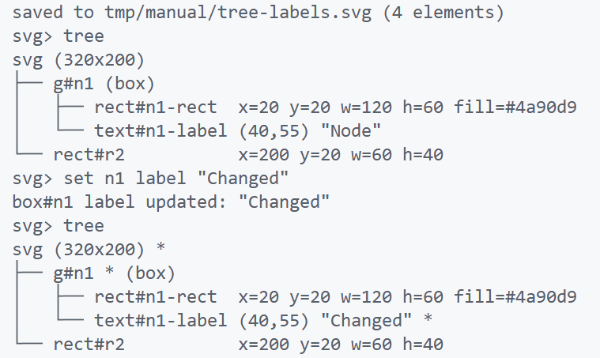</p>

_图 6　保存后仅保留 `(box)`；修改标题后，画布、box 容器与文字标星，内部矩形和兄弟矩形保持无星号。_

<p align="center">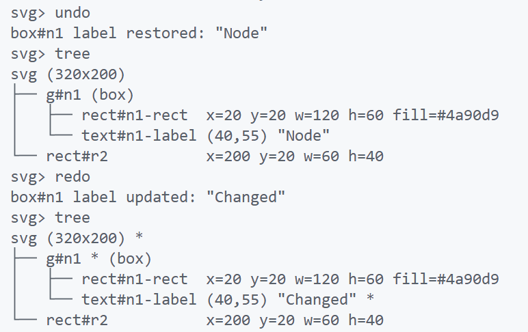</p>

_图 7　一次 `undo` 恢复保存点并移除星号；`redo` 后星号按同一语义重新出现。_

### 5.4 选做扩展：`diamond`

`diamond` 判断框是对图形扩展契约的额外验证。插件把边界框转换为四个顶点，并通过公开的 `ShapeCreationContext` 请求已注册的 `line` 提供者生成四条边；它不导入内置线段类，也不修改内核、SVG 适配器或既有插件。判断框作为一个受保护的 Composite 整体参与移动、缩放、删除及 undo/redo，必要边不能被单独删除、移出或解组。

<p align="center">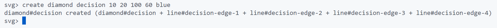</p>

_图 8　`diamond` 插件通过已注册的 `line` 提供者创建四条必要边，并以一个复合图形返回。_

序列化使用 `<g data-kind="diamond">` 和四个标准 `<line>` 子节点。安装插件时恢复语义对象并校验子节点类型、派生 id、顺序和数量；未安装时由既有 SVG 读回路径自然降级为普通 `g`。插件本体提交 `4ca73a5` 不修改 `src/`，代码装配提交 `2438607` 只修改组合根及测试，配置装配提交 `9458770` 不修改任何既有运行源码，因而直接证明新增图形不要求扩张内核分支。

## 6. 两种插件装配方式

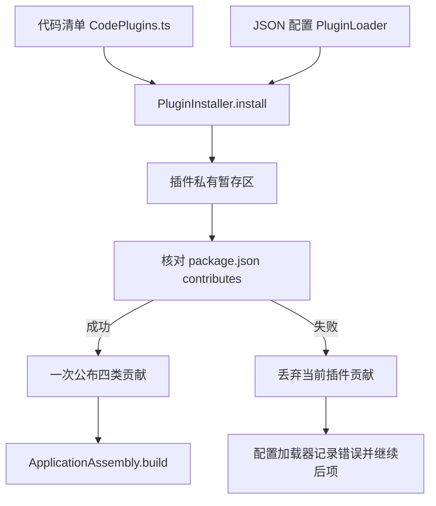

代码方式由 `createCodeApplication` 读取 `CodePlugins.ts`；新增插件只需在组合根选择安装项并重新构建。配置方式由 `createConfiguredApplication` 调用 `PluginLoader`，加载器不包含插件名称映射或插件专用分支。两种入口最终都调用 `PluginInstaller.install`，再由 `ApplicationAssembly.build` 使用同一组贡献构造注册表、编辑会话、SVG 适配器和 CLI。

仓库根目录提交了可直接运行的 `plugins.config.json`。数组顺序就是安装顺序；`enabled: false` 完全跳过；相对模块路径以配置文件目录为基准，包名按当前 Node 模块解析环境处理；`options` 作为只读未知值原样传给插件并由插件解释。带 UTF-8 BOM 的合法配置也可读取。

```json
{
  "plugins": [
    { "module": "./plugins/modified-star/index.ts" },
    { "module": "./plugins/box/index.ts" },
    { "module": "./plugins/diamond/index.ts" },
    { "module": "./plugins/stats/index.ts" },
    { "module": "./plugins/dir/index.ts" }
  ]
}
```

插件包在 `package.json` 的 `contributes.shapes/commands/decorators/attributes` 中声明稳定名称，缺省类别按空集合处理。安装器为每个插件创建私有暂存区，只有在激活成功、四类清单与实际注册集合一致且不存在重名时才一次公布贡献。清单不符、重名或激活失败都只丢弃当前插件的全部暂存贡献，先前成功插件保持可用；配置加载器捕获单项错误后继续处理后续插件。模块入口存在但求值或内部依赖失败归为插件激活失败，不误报为顶层模块不存在。完整事务见 [ADR-012](adr/ADR-012-plugin-installation-transaction.md)。

| 失败类别           | CLI 输出与行为                                                         |
| ------------------ | ---------------------------------------------------------------------- |
| 配置语法或结构非法 | `error: invalid plugin config`，随后以默认内置能力启动                 |
| 顶层模块不存在     | `error: plugin not found: <module>`                                    |
| 模块没有默认导出   | `error: plugin has no default export: <module>`                        |
| 声明与实际注册不符 | `error: plugin manifest mismatch: <name> (declared: …, registered: …)` |
| 激活或模块求值失败 | `error: plugin failed to activate: <name> (<reason>)`                  |
| 同类注册名重复     | `error: duplicate registration: <category>/<name>`                     |

在插件集合、顺序、options、输入、初始 SVG 和固定工作目录相同时，自动测试已经逐字节比较代码装配与配置装配的 Phase 1 §6 基础会话、§6.1 box 会话以及 stats/dir 会话。输入夹具只包含命令和注释，不混入提示符或预期输出；`dir` 使用内容固定的临时目录，并把日志置于目录之外。禁用全部可选插件时，两份 Phase 1 会话的标准输出和保存 SVG 与 `final` 基线逐字节一致。

扩展性边界由依赖检查和装配职责共同保证：新增插件只实现公开接口并提供清单；方式 A 的 `0342080` 只在顶层装配入口启用已经独立实现的 `stats`，没有修改内核或既有插件；方式 B 的仓库级 `plugins.config.json` 不修改任何已有运行源码，并由端到端测试通过生产加载器安装完整插件集。内核、加载器与既有插件均不需要识别新插件名称。

接入差异可直接复核。方式 A 的插件实现先独立提交，`0342080` 是接入提交；在运行源码范围中只修改顶层 `src/main.ts`，内核与既有插件差异为空：

<p align="center">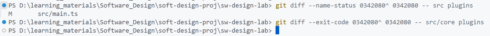</p>

_图 9　代码装配接入只修改顶层入口；针对 `src/core` 与既有 `plugins` 的差异检查为空。_

方式 B 的提交号可由仓库级配置文件唯一定位。该提交只增加配置、测试和说明，不修改 `src/` 或既有插件：

<p align="center">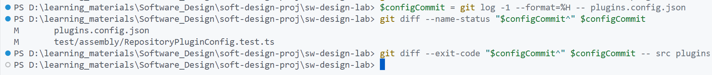</p>

_图 10　配置装配提交只修改仓库配置及其测试；针对 `src` 与既有 `plugins` 的差异检查为空。_

图 9、图 10 中的命令都先使用真实存在的路径，再检查内核与既有插件差异，避免把错误路径产生的空输出当作证据。

## 7. 关键设计决策

### 7.1 设计模式及实现位置

本阶段实际采用三种经典 GoF 模式，并使用一个具有装饰意图的树标签扩展机制。下表明确区分模式角色、项目实现和详细说明位置，避免仅凭类名认定模式：

| 模式或机制                          | 项目中的参与者与协作                                                                                                                                                        | 详细说明位置                                                                                                                                                       |
| ----------------------------------- | --------------------------------------------------------------------------------------------------------------------------------------------------------------------------- | ------------------------------------------------------------------------------------------------------------------------------------------------------------------ |
| Command                             | `EditCommand` 封装可撤销编辑请求，`SvgDocument` 是 Receiver，`CommandExecutor` 只在成功后记录局部撤销信息；CLI 扩展点 `Command` 负责外部命令注册与调用，不另建一套编辑历史  | [ADR-005“模式协作”](adr/ADR-005-phase2-plugin-boundaries.md#模式协作代价与验证)、[ADR-007](adr/ADR-007-command-registration.md)，以及 §4.2 的 `Command` 扩展点清单 |
| Composite                           | 叶子图形与容器共享图形抽象，普通 `g`、`box` 和 `diamond` 统一参与移动、缩放、删除与树投影；具体容器通过窄约束保护必要子节点                                                 | §5.2、§5.4，[ADR-006](adr/ADR-006-shape-provider-and-model-split.md) 与 [ADR-011](adr/ADR-011-box-read-and-structure-protection.md)                                |
| Adapter                             | `DirectoryReader` 是 `dir` 客户端拥有的 Target，`NodeDirectoryReader` 把 Node 文件系统的 `Dirent` 转为中性目录项；VSCode Provider 也承担从 URI/XML 文本到宿主契约的接口转换 | §3.2、§5.1 的角色图，以及 [ADR-008](adr/ADR-008-dir-adapter-and-special-entries.md)                                                                                |
| 树标签装饰扩展（非经典 GoF 包装链） | `TreeDecorator` 只读取画布或 `ShapeView` 并贡献可选标签，`TreeDecoratorRegistry` 按注册顺序组合；`TreeFormatter` 仍独占枝线、列对齐和主体文本，插件之间不互相包装           | §5.3 与 [ADR-010](adr/ADR-010-tree-decoration-and-dirty-semantics.md)；§3.2 另行说明 VSCode File Decoration API 也不等同于 GoF Decorator                           |

插件注册表、`ShapeProvider`、组合根和安装事务是支撑开放封闭与依赖倒置的架构机制，不因名称相似而额外宣称为 GoF 模式。模式选择以真实变化点为依据：单次 DFS 没有抽象为 Iterator，新增图形也没有采用要求集中枚举类型的 Visitor。

### 7.2 架构决策记录

Phase 2 的重要取舍均以 ADR 固化，避免实现与报告采用不同语义：

| ADR                                                           | 决策主题                                       |
| ------------------------------------------------------------- | ---------------------------------------------- |
| [ADR-005](adr/ADR-005-phase2-plugin-boundaries.md)            | 内核、宿主、适配器、内置实现和插件的依赖边界   |
| [ADR-006](adr/ADR-006-shape-provider-and-model-split.md)      | 图形提供者构造分离树，文档统一验证、接入和撤销 |
| [ADR-007](adr/ADR-007-command-registration.md)                | 内置命令与插件命令共用注册和分派路径           |
| [ADR-008](adr/ADR-008-dir-adapter-and-special-entries.md)     | 目录访问端口及特殊文件项规则                   |
| [ADR-009](adr/ADR-009-attribute-handler-contract.md)          | 属性处理器冲突、原子修改和失败回滚             |
| [ADR-010](adr/ADR-010-tree-decoration-and-dirty-semantics.md) | 保存点、祖先传播和多标签顺序                   |
| [ADR-011](adr/ADR-011-box-read-and-structure-protection.md)   | box 异常读回、缺省降级与必要子节点保护         |
| [ADR-012](adr/ADR-012-plugin-installation-transaction.md)     | 清单校验时机、暂存注册和错误隔离               |

## 8. 测试与质量保证

### 8.1 验收覆盖

常规质量门禁如下：

```powershell
npm run typecheck
npm run lint
npm run format:check
npm run deps:check
npm run tracked:check
npm test
npm run coverage
```

验收测试中，CLI 侧 89 个测试文件、452 项测试全部通过，VSCode 扩展 8 项单元测试通过。测试覆盖四个扩展点、插件独立行为、禁用路径、属性部分失败回滚、box 与 diamond 的读回和结构保护、加载失败隔离、仓库级配置、真实文件系统 Adapter、真实 CLI 进程、代码/配置双装配，以及 Phase 1 标准输出和保存 SVG 的逐字节基线。CLI 覆盖率为 statements/lines 96.28%、branches 约 92.4%、functions 99.31%，高于仓库设置的 statements/lines/functions 95%、branches 90% 全局门禁。

题目中的功能判据与最终证据对应如下：

| 验收域           | 关键判据                                                                                       | 报告与验证证据                                                  |
| ---------------- | ---------------------------------------------------------------------------------------------- | --------------------------------------------------------------- |
| VSCode A.1–A.3   | 仅 SVG 文件显示 `[]`；原生 Outline 层级、定位、编辑刷新与不完整 XML 容错；职责、模式和复用分析 | 第 3 节、8 项单元测试、隔离宿主测试及图 1～3                    |
| 四个扩展点       | 接口归内核；插件只依赖公开面；注册、调用、缺省和违规契约均可核验                               | 第 4.2 节扩展点清单、依赖反例及各注册表契约测试                 |
| `stats` 与 `dir` | 精确输出、帮助与启停；不改变历史；`dir` 无文档可用并通过 Adapter 访问真实文件系统              | 第 5.1 节、图 4、替身/临时目录测试及双装配会话                  |
| 属性与 `box`     | fill/label 一次撤销；冲突和部分失败原子回滚；box 创建、嵌套、读回降级及必要子部件保护          | 第 5.2 节、图 5、ADR-009/011 及 Phase 1 §6.1 会话               |
| 树标签           | 保存点 dirty、新节点与祖先传播、标签顺序、实例状态；无标签时保持旧输出                         | 第 5.3 节、图 6～7、ADR-010、状态机测试及 Phase 1 tree 字节基线 |
| 两种装配         | 同一安装路径；清单、重名和四类加载故障可回滚并继续；A/B 输出逐字节相同                         | 第 6 节、图 9～10、加载器测试和 A/B 进程级比较                  |

其中两条跨功能不变量由全部错误路径共同验证：**失败不改变文档、dirty 或 undo/redo 历史；禁用可选插件时 Phase 1 输出与保存 SVG 逐字节不变。** 更细的要求—证据映射见 [Phase 2 验收矩阵](phase2/requirements.md)。

### 8.2 架构规模与复杂度对照

`scripts/generate-metrics.mjs` 直接读取 Git 对象，按“CLI 内核 / 装配与技术支持 / 内置及可选插件 / VSCode 扩展”统计文件、物理行数和基于 TypeScript AST 的圈复杂度。下表以 `final` 为 Phase 1 基线，以本报告对应的 Phase 2 交付树为对照：

| 分类                | Phase 1 行数 | Phase 2 行数 | Δ行数 | Phase 1 圈复杂度 | Phase 2 圈复杂度 | Δ复杂度 |
| ------------------- | -----------: | -----------: | ----: | ---------------: | ---------------: | ------: |
| CLI 内核            |         2606 |         2253 |  -353 |              486 |              425 |     -61 |
| 装配与技术支持      |          693 |         1220 |  +527 |              222 |              337 |    +115 |
| 内置及可选插件      |            0 |         1362 | +1362 |                0 |              271 |    +271 |
| VSCode 扩展（单列） |            0 |          118 |  +118 |                0 |               19 |     +19 |

内核行数减少 353、圈复杂度减少 61，表明具体图形、插件命令和标签行为已从稳定内核中分离；装配与插件代码的增长来自新增的加载、契约校验和可选能力。完整的统计口径、文件职责、行数和复杂度清单见[可复现指标](../docs/metrics/metrics.md)。指标可由下列命令从 Git 对象重新生成，无需依赖工作区文件或人工填写数值：

```powershell
npm run metrics:generate -- --base final --target HEAD --target-label p2 `
  --output docs/metrics/metrics.md
```

## 9. AI 协作与结果核验

AI 作为分析与审阅工具，用于需求条目归纳、设计方案比较、测试边界补充以及文档一致性检查，不直接作为功能正确性的证明。所有进入交付成果的建议均经过独立证据核验：

| 协作事项       | 核验依据                                          | 修正与控制结果                                                     |
| -------------- | ------------------------------------------------- | ------------------------------------------------------------------ |
| 需求与行为判据 | Phase 1/2 题目原文、逐字节基线、真实 CLI 进程输出 | 将错误文本、原子性、禁用路径和兼容性落实为可重复执行的测试         |
| 架构与依赖方向 | 实际导入关系、ADR、`deps:check` 和架构预检        | 使架构图、源码目录、依赖白名单和指标分类采用同一模块边界           |
| 插件契约       | 契约测试、故障注入、代码与配置双装配 A/B 比较     | 覆盖重名、清单不符、激活失败、回滚和后续插件继续加载等反例         |
| 界面与报告证据 | VSCode 隔离宿主、人工操作截图、仓库内原始图片     | 仅陈述可观察的 Outline、定位、刷新和装饰结果，不以推断代替界面验证 |

核验过程中发现的表述或模型不一致均以实现事实为准修正。例如，架构图按真实导入关系区分内核、装配层和插件；SVG 图片预览被识别为编辑器关联行为，而非 Outline 定位失败；带 UTF-8 BOM 的 JSON 配置则通过真实进程测试纳入兼容性验证。相关修正已体现在代码、测试、架构图和本报告中。

## 10. 交付证据与发布规则

代码、扩展源码、示例 SVG、ADR、两张架构图、自动测试、可复现指标、五张 VSCode 界面证据及七张 CLI/Git 终端证据均位于仓库内。`final` 固定指向 Phase 1 基线，`p2` 用于标识与本报告、源码和验证材料一致的 Phase 2 交付版本。

详细的要求—证据对应关系见 [Phase 2 验收矩阵](phase2/requirements.md)。
