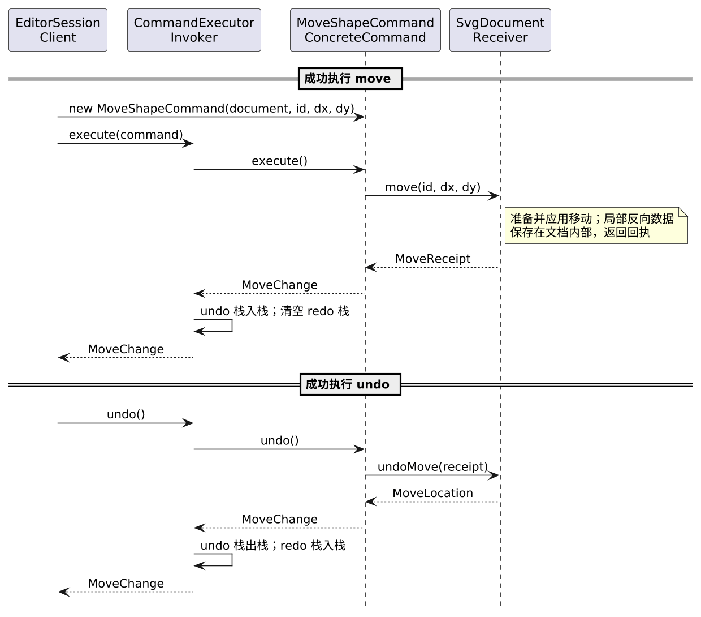
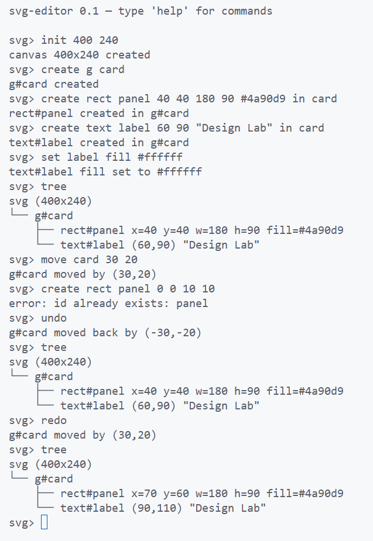
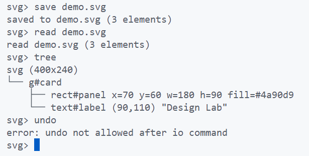
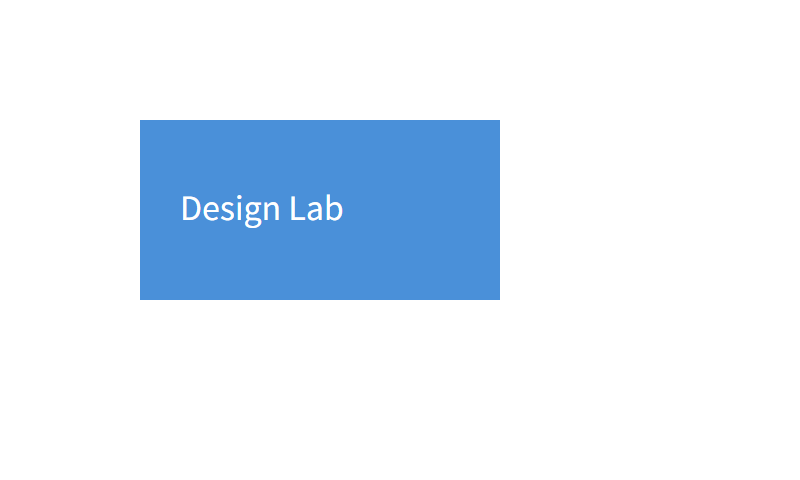

# Lab Phase 1：SVG 命令行编辑器

**运行方式**

在仓库根目录安装依赖并启动命令行编辑器：

```powershell
npm ci
npm run cli
```

启动后输入 `help` 可查看命令语法。

## 1. 报告范围

本实验使用 TypeScript 实现一个 SVG 命令行编辑器。用户通过图形 id 定位对象，逐行输入命令，在画布中创建矩形、圆形、椭圆、线条、文字和分组容器；图形可以嵌套，并支持删除、移动、缩放、属性设置、分组、解组及同级顺序调整。成功的编辑命令可以撤销和重做；失败命令不改变文档与编辑历史。

编辑器可以读取和保存本阶段支持的 SVG 子集，保留图形层级、顺序、文本与显式样式，并提供树形结构和单个图形的查询命令。本报告针对 Phase 1 的六种内置类型；`box` 等插件扩展属于后续阶段。以下依次说明架构方案、过程记录、一致性自查和质量保证手段。

## 2. 架构方案

### 2.1 模块划分

代码按需要封装的规则分为四个业务模块：图形与树结构、编辑会话与历史、SVG 持久化、命令行协议。各模块的职责与边界如下。

| 模块          | 主要职责                                                                                                                             | 边界                                        |
| ------------- | ------------------------------------------------------------------------------------------------------------------------------------ | ------------------------------------------- |
| `src/model/`  | 文档树、id 与局部撤销状态（`SvgDocument`）；图形几何与多态操作（`Shape` 子类）；CLI 参数、SVG 属性映射及图形创建（`ShapeFactory`）。 | 不解析整行命令，不操作 XML DOM 或文件系统。 |
| `src/editor/` | 会话、读入路径与具体命令创建（`EditorSession`）；历史与不可撤销操作后的屏障（`CommandExecutor`）；文档读写端口（`DocumentStore`）。  | 不解析 SVG，不决定图形几何或树结构规则。    |
| `src/svg/`    | SVG 子集编解码（`SvgCodec`）；文件读写与存储端口实现（`SvgFileStore`）。                                                             | 不管理编辑会话或命令历史。                  |
| `src/cli/`    | 单行输入解析（`CommandLineParser`）；命令分发与反馈（`CliApp`）；树形排版（`TreeFormatter`）。                                       | 不直接访问领域可变状态或操作文件系统。      |

`src/main.ts` 是进程入口，不是第五个业务模块：它装配 `CliApp`、`EditorSession` 和 `SvgFileStore`，并用 `readline` 管理输入流、横幅和提示符，不执行领域业务规则。下方 PlantUML 组件图的箭头表示**源码导入依赖**，不是运行时请求方向；虚线专指 `svg` 对 `editor/DocumentStore` 的类型依赖。外部 Node API 和 XML 库未画入工程内模块图。


源文件：[PlantUML 组件图](assets/architecture.plantuml)。

### 2.2 设计模式的选择与实现

本阶段使用 Command 管理可撤销的编辑请求，使用 Composite 统一处理叶子图形与嵌套容器，使用 Adapter 隔离编辑会话与文件、XML 操作。下文分别说明这些模式解决的问题、代码中的参与者以及采用它们的代价。

#### 命令模式（Command）

题目规定一条编辑命令对应一个撤销单元，撤销后还可能重做。请求必须能够保存并重放，因此适合封装为命令对象；仅为一次方法调用增加命令类则会造成过度设计。

`EditCommand` 定义执行、撤销、重做契约；`EditorSession`（Client）创建具体命令并交给 `CommandExecutor`（Invoker）；具体命令绑定请求与 `SvgDocument`（Receiver），保留本次操作的回执。领域对象负责业务校验、状态变更和局部反向数据，执行器仅在成功后更新历史栈。这样，`group` 等涉及多节点的编辑仍作为一条命令撤销，失败也不会留下历史记录。

以下时序图以成功执行 `move` 后撤销为例，箭头表示对象调用及返回。`MoveShapeCommand` 保存回执，`SvgDocument` 私有保存对应的局部反向数据；历史栈在领域操作成功返回后才更新。



源文件：[PlantUML 时序图](assets/command-move-undo.plantuml)。

直接由 CLI 或会话调用领域方法虽然能完成单次编辑，却会使各操作的历史处理分散。Command 的代价是每种编辑操作都需要具体命令类和参数传递，因此只用于可撤销编辑；`init`、`read`、`save` 与画布尺寸修改按题目规定形成历史屏障，不包装成可撤销命令。撤销信息按操作保存，不使用整份文档快照。

#### 组合模式（Composite）

题目要求嵌套 `g` 与叶子图形统一接受适用的 `move`、`scale`、`set`、`delete`。若由命令或 CLI 按类型分支，再分别遍历后代，新增图形和嵌套层级都会扩大改动范围。

`Shape` 是叶子与容器的共同抽象；五种基础图形是叶子，`GroupShape` 持有有序的 `Shape` 子节点。组递归组合子图形的移动、缩放和子树遍历能力，`SvgDocument` 按 id 统一定位并操作目标。移动和缩放在应用前准备后代的操作计划，避免某个后代校验失败后留下部分修改。

在共同的图形操作上，组和叶子图形都可作为 `Shape` 使用；各子类重写操作方法，`SvgDocument` 在移动、缩放等操作中无须按具体图形类型分支。组特有的子节点管理由 `GroupShape` 实现，父子关系则通过持有 `Shape` 对象建立，而非扩展继承层次。代价是领域层须维护树的顺序、归属和递归操作；普通组的公共样式保存在组自身，由 SVG 继承规则作用于后代，子图形的显式样式保持独立。

#### 适配器模式（Adapter）

编辑会话需要按路径读写完整文档；Node 文件 API 提供文件操作，XML 编解码器负责语法映射，两者均不提供会话所需的文档级接口。由客户端需求定义 Target，可以使编辑流程不依赖底层能力的接口形状。依此，`editor` 定义文档级 `DocumentStore`（Target），`SvgFileStore`（Adapter）实现该接口并协调文件操作与 `SvgCodec`；`EditorSession`（Client）只依赖 Target，`main.ts` 注入真实实现。

若由会话直接使用文件和 XML API，持久化细节会进入编辑流程；适配器隔离了接口形状、错误转换和文件写入规则，并允许会话测试使用存储替身。其代价是增加一个端口和适配实现。被适配能力来自 Node 文件 API 与 `SvgCodec`，并非单个已注入的 Adaptee 对象：适配器可接收编解码器，却仍直接调用文件 API。当前没有第二文件后端，因此不再增加仅用于注入底层文件操作的端口；真实文件测试检验该边界。

#### 其他模式的取舍

Decorator 适用于通过同接口包装对象来动态叠加职责；本阶段的样式是图形属性与 SVG 继承，不存在同接口包装链。Visitor 适于元素类型稳定而操作频繁增加的结构，而题目已预告新图形 `box`，提前引入双分派会增加新增类型的改动范围。当前也没有需要动态订阅的多方观察者；树遍历由现有多态方法完成，无须另设 Observer 或 Iterator 层。`ShapeFactory` 集中创建内置类型，但没有采用 GoF Factory Method，插件注册机制留待后续阶段。

### 2.3 依赖方向规则

下表中的“允许依赖”指跨目录的源码导入；模块内部导入不另列。该约束以业务规则不依赖输入协议和持久化技术为原则。

| 发起模块      | 允许依赖                         | 原因与边界                                                                               |
| ------------- | -------------------------------- | ---------------------------------------------------------------------------------------- |
| `model`       | 无其他业务模块                   | 领域规则不导入命令行、会话或 XML 实现；输入规则的语义耦合见第 2.4 节。                   |
| `editor`      | `model`                          | 会话和命令调用领域操作；存储需求由本模块的 `DocumentStore` 端口定义，不导入 `svg` 实现。 |
| `svg`         | `model`；`editor` 的存储端口类型 | 编解码需要文档及图形投影；文件适配器实现客户端定义的端口，不访问命令历史。               |
| `cli`         | `editor`                         | 命令解析与文本格式化使用会话 API 和结构化结果，不直接依赖领域内部状态或具体文件实现。    |
| `src/main.ts` | 四个业务模块                     | 仅作为组合根及 REPL 进程入口；现有代码直接导入 `cli`、`editor`、`svg`。                  |

XML 解析库与文件系统 API 均封装于 `svg`，标准输入输出由 `main.ts` 管理。`svg` 对 `editor` 的依赖限定为 `DocumentStore` 类型；`editor` 不引用具体的 SVG 持久化实现。新增跨模块依赖须遵守表中规则，规则变更须同步修订架构决策。

### 2.4 变化点假设与预留边界

按题目明确的后续目标，优先考虑以下变化。当前仅需支持六种内置图形、单一 CLI 入口和严格 SVG 子集，因此没有为尚未确定的扩展契约引入注册系统或通用展示协议。表中同时列出已具备的边界与未来改动范围。

| 可能变化及依据                     | 已有隔离或扩展能力                                                                                            | 未预留的能力与预计改动                                                                                                               |
| ---------------------------------- | ------------------------------------------------------------------------------------------------------------- | ------------------------------------------------------------------------------------------------------------------------------------ |
| 新图形与复合 `box`（题目后续阶段） | `Shape` 多态操作、`GroupShape` 递归组合和有类型的 `ShapeSpec` 为新图形提供领域基础。                          | Phase 1 仅内置六类；尚无 `ShapeProvider` 注册机制。新增 `box` 将涉及集中工厂、读写和相关展示规则，尚不具备核心代码零修改的插件能力。 |
| 新编辑操作（后续迭代）             | `EditCommand`、`CommandExecutor` 与 Receiver 将请求、历史和业务规则分开；每项操作保存局部反向数据。           | 新操作仍需增加领域方法、具体命令和会话入口，并在 CLI 集中分发处接入；未设置通用命令注册系统。                                        |
| SVG 兼容范围或解析库变化           | `SvgCodec` 隔离 XML DOM，`SvgFileStore` 隔离文件操作，`DocumentStore` 保持会话所需的文档级契约。              | 更换 XML 库主要影响 `svg`；扩展受支持元素或属性还可能修改 `ShapeFactory`。未实现完整 SVG、`transform` 或无损透传。                   |
| 交互入口或输出格式变化             | `EditorSession` 提供结构化编辑与查询结果，CLI 的解析、树形排版和反馈文本留在 `cli`，进程 I/O 留在 `main.ts`。 | 新入口需要单独适配与装配；当前没有事件总线、GUI 框架或跨入口通用展示协议。                                                           |

`ShapeFactory` 同时解释 CLI 图形参数位置与受支持的 SVG 属性，是当前集中管理图形输入规则的地方，也是格式扩展时可能放大的耦合点。保留这一集中映射可避免在多个模块重复按图形类型分派；若后续变化使两种输入规则独立演进，再评估拆分。

## 3. 过程记录

以下选取四次影响架构或正确性的判断，按方案选择、边界调整、缺陷修正和模式核验的顺序记录。

### 3.1 以改动范围比较模块方案

AI 协助提出四模块与六模块两种方案。我用“新增编辑操作需要修改哪些模块”检验方案：会话、命令和历史共同维护一次编辑，拆成三个目录会增加跨模块接口；图形规则、文件格式和 CLI 协议则应各自封装。因此选用四个业务模块，将会话、命令和历史归入 `editor`。实现后再核对实际导入关系，而非仅凭目录名称判断方案是否落地。候选方案与依赖规则见 [ADR-001](adr/ADR-001-module-boundaries.md)。

### 3.2 收紧回执与树查询的边界

早期实现已能完成编辑和撤销，但公开回执包含可变图形对象、父节点和位置，树查询也在领域层拼接展示文本。我判断这两处会使外层依赖领域内部结构，并使输出格式变化牵动图形类。

调整后，`SvgDocument` 私有保存反向状态，命令只持有不透明回执；领域层提供结构化树信息，由 CLI 排版。[回执封装测试](../test/model/ReceiptEncapsulation.test.ts)确认外部无法从回执取得活动图形或树位置；树形输出测试核对了格式与层级。

### 3.3 用失败场景检验撤销恢复

正常撤销测试通过后，我检查了底层恢复接口的异常调用顺序：若原父组已脱离文档，恢复子图形可能使树与 id 索引不一致；同 id 的新组也不能代替原父组。我先加入这两种失败场景，再要求恢复操作核验父组对象身份。[领域测试](../test/model/SvgDocument.test.ts)确认失败时树和索引不变，原父组恢复后仍可正确恢复子图形。对应提交：`c95b594`。

### 3.4 核对 Adapter 的实际协作

AI 辅助生成的早期说明把 `SvgFileStore` 写成“通过构造器接收文件与解析依赖”，暗示文件 API 可以注入。我手工核对 `DocumentStore`、`EditorSession`、`SvgFileStore` 的接口与构造器，以及 `main.ts` 的装配，确认构造器只允许传入 `SvgCodec` 实例，文件操作仍直接调用 Node API。因此需要修正的是模式说明，而非代码。

修订后的说明明确了实际参与者：`DocumentStore` 是 `editor` 定义的 Target，`EditorSession` 是只依赖该端口的 Client，`SvgFileStore` 是实现端口并协调 `SvgCodec` 与文件 API 的 Adapter；`main.ts` 将适配器注入会话。会话可替换存储实现，适配器可接收编解码器实例，但文件 API 没有注入点。我再对照会话存储替身测试和真实文件读写测试，分别确认端口替换与文件行为。本阶段没有第二种文件后端，因此未增设文件操作端口。对应提交：`e16cd25`。

## 4. 一致性自查

### 4.1 模块划分

**结论：实际目录与第 2.1 节方案一致，没有需要补记的目录级偏离。** `src/` 下是 `model`、`editor`、`svg`、`cli` 四个业务目录和进程入口 `main.ts`。目录数量本身不能证明职责划分有效，因此又用开发中的三项变化检查了代码的实际落点：

| 变化          | 实际落点                                          | 对模块边界的检验                                    |
| ------------- | ------------------------------------------------- | --------------------------------------------------- |
| 收紧撤销回执  | `model` 保存反向状态，`editor` 的命令只持有回执   | 命令历史没有接管图形树的恢复规则。                  |
| 调整树形输出  | `model` 提供结构化图形信息，`cli` 负责文本排版    | 输出格式的修改不要求领域对象拼接命令行文本。        |
| 加入 SVG 读写 | `svg` 实现文件与 XML 转换，`main.ts` 装配存储实现 | 编辑会话仍通过自身定义的 `DocumentStore` 读写文档。 |

普通组样式、分组位置和读写范围的行为决定分别见 [ADR-002](adr/ADR-002-group-style-semantics.md)、[ADR-003](adr/ADR-003-group-placement.md) 和 [ADR-004](adr/ADR-004-svg-io-scope.md)；这些决定没有改变四模块方案。

### 4.2 依赖方向

**结论：未发现违反第 2.3 节规则的源码导入。** 依赖检查覆盖 `src/` 中 127 条相对导入和 6 条外部导入，除目录方向外，还限定 `svg` 只能以类型形式导入 `editor/DocumentStore`，第三方 XML 库只由 `svg` 使用。Node 文件、路径和随机数 API 位于 `svg`，`readline` 位于 `main.ts`。

源码抽查进一步确认了各模块的实际协作：`CliApp` 使用会话与结构化结果，`EditorSession` 调用领域对象并持有存储端口，`SvgFileStore` 实现该端口，`main.ts` 完成具体装配。`model` 不导入外围业务模块，`editor` 不引用 `svg` 实现。自动检查约束导入边界，源码审查核对对象的实际职责，两者共同支持上述结论。

## 5. 质量保证手段

### 5.1 功能覆盖与分层验证

[需求与验收清单](requirements.md)将题目的命令、状态规则和两段完整会话对应到正常、失败、边界与撤销重做场景，作为实现和测试的核对依据。例如，`group` 除检查创建结果，还检查成员顺序、一次撤销还原结构，以及无效目标失败后状态不变。

| 验证层次   | 核对重点                                  | 主要证据                                                            |
| ---------- | ----------------------------------------- | ------------------------------------------------------------------- |
| 领域对象   | 几何、树结构、图形顺序与失败原子性        | [领域测试](../test/model/)                                          |
| 编辑会话   | 单命令撤销重做、历史屏障与失败后历史不变  | [编辑测试](../test/editor/)                                         |
| SVG 读写   | 支持子集、缺失 id、往返结果与文件写入失败 | [读写测试](../test/svg/)                                            |
| CLI 与进程 | 输出格式、两段完整会话及真实标准输入输出  | [CLI 测试](../test/cli/)、[固定会话](../test/fixtures/transcripts/) |

两段会话逐条核对题目给出的文本；保存操作还从实际文件读回图形树、顺序、样式和文本，避免只检查成功提示。

**嵌套编辑与撤销重做。** 重复创建 `panel` 失败后，`undo` 仍撤销先前的整组移动；`redo` 再次移动矩形与文字。前后两次树形结果给出了坐标变化。



**文件往返。** 保存后重新读入 `demo.svg` 得到 3 个元素，树形结构与保存前一致；读入后撤销受到历史屏障限制。



**渲染结果。** 同一 SVG 在白色预览背景上显示蓝色矩形与白色文字；白色背景属于查看器，文件中的画布仍为透明。



### 5.2 工程校验与人工复核

自动化测试共 178 项，类型检查、Lint、格式检查和依赖检查均通过；可执行源码的语句覆盖率为 96.17%，纯类型声明文件与进程入口不计入统计。[依赖规则测试](../test/scripts/CheckDependencies.test.ts)还使用合法与违规导入样例，确认检查器能够拒绝越界引用。覆盖率用于发现未触及的代码，功能结论仍以具体行为断言为依据。

下列命令均在仓库根目录执行：

| 命令                                                          | 用途                                    |
| ------------------------------------------------------------- | --------------------------------------- |
| `npm test` / `npm run test:watch`                             | 单次运行全部测试 / 开发时持续运行测试。 |
| `npm run coverage`                                            | 运行测试并生成覆盖率报告。              |
| `npm run typecheck` / `npm run lint` / `npm run format:check` | 检查类型、代码规范和格式。              |
| `npm run deps:check` / `npm run tracked:check`                | 检查模块依赖及 Git 跟踪文件范围。       |

AI 协作遵循“需求场景—方案比较—测试—实现—审查”的顺序。生成的代码和说明由我对照题目、依赖方向与实际调用关系核验；发现缺陷时先建立可复现的场景，再修正实现。Git 提交按可验证的能力和独立修正组织，使设计选择与纠错过程能够追溯。

验证范围是已列明的 Phase 1 场景与受支持的 SVG 子集。题目未规定的反馈文本及边界语义按项目约定实现，并在需求与验收清单中单独标明。
