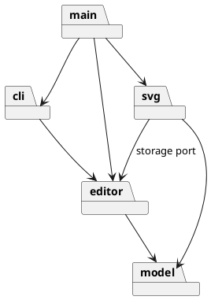

# Lab1 Phase 1：SVG 命令行编辑器

> 本文档记录课程要求的架构方案、代表性设计过程和验证依据。功能验收以仓库外的 `phase_cli_1.md` 为准；命令契约与未决问题见 [`requirements.md`](requirements.md)。

## 1. 当前阶段

需求与模块边界已确定；当前可运行切片覆盖 `init`、`read`、`save`、`canvas`、六种内置图形的 `create`、`tree`、`show`、`help`、`delete`、`move`、`scale`、`set`、`group`、`ungroup`、`addto`、`front`、`back`，以及相应的 `undo`/`redo`。题目两段 Phase 1 会话已逐命令回放，`requirements.md` 列明的验收场景均有自动化测试。未决语义和最终交付审计仍待处理；插件能力属于后续阶段，不在本阶段实现。

## 2. 架构方案

### 2.1 模块划分

| 目录          | 职责                            | 边界                       |
| ------------- | ------------------------------- | -------------------------- |
| `src/model/`  | 画布、图形、层级、id 和几何规则 | 封装领域状态，提供只读查询 |
| `src/editor/` | 会话、Command、执行器和撤销重做 | 协调编辑，不承载图形规则   |
| `src/svg/`    | SVG/XML 解析、序列化与文件适配  | 隔离 I/O 和第三方库        |
| `src/cli/`    | 命令解析、分发及输出            | 只依赖编辑能力             |
| `src/main.ts` | 装配和 REPL 入口                | 不承载业务规则             |

四个模块均已有实际职责；`src/svg/` 在读写切片落地，隐藏 XML 库与文件系统。模块包图：

### 2.2 设计模式与依赖方向

题目要求的 Command 用于把一次编辑请求变成一个撤销单元：具体命令调用 `model` Receiver，只保存本次操作所需的反向信息；执行器管理历史。Composite 用于让叶子图形与 `g` 容器在适用编辑操作上共享抽象。两者的参与者与测试要求见 [`ADR-001`](adr/ADR-001-module-boundaries.md)。`DocumentStore` 是 editor 定义的客户端接口；`SvgFileStore` 组合 XML 编解码与文件 API 实现接口适配，真实读写由装配入口注入，单测可替换存储。没有为模式名称额外增加无职责的转发层。

命令持有不透明的操作回执，文档内部保存对应图形、原位置和几何恢复计划；回执对外只提供回显摘要，撤销不使用整份文档快照。创建请求在工厂边界转成有类型的 `ShapeSpec`，领域文档不接收 CLI 位置参数；`tree` 的领域投影只包含几何与文本事实，由 CLI 负责缩写、箭头、引号和对齐。

允许 `cli → editor → model`、`svg → editor/model`，`main` 负责装配。禁止 `model` 反向依赖外围模块、`editor` 依赖具体 SVG 适配器、`cli` 直接读写领域内部状态。后续以实际 import 检查。

### 2.3 变化点与取舍

- 新图形类型：Phase 1 仅内置题目六类，集中名称分派；后续 `box` 插件才考虑注册机制。
- 输入边界的实际取舍：词法解析留在 `cli`，DOM 与文件 API 留在 `svg`；`model/ShapeFactory` 集中掌握六种图形的 CLI 参数位置、受支持 SVG 属性和类型到类的实例化规则。领域文档只接收有类型的 `ShapeSpec`，不接收原始命令参数或 DOM。工厂仍知道两种输入格式的模式，属于 Phase 1 的明确耦合；后续插件迭代再评估注册式方案，不预称内核零改动。
- `<g transform>` 当前按用户确认的严格读入子集拒绝，待教师澄清是否属于验收范围；跨父 `group` 的位置与顺序按 ADR-003 执行。
- `front/back` 的视觉层级按 [SVG 1.1 绘制顺序](https://www.w3.org/TR/SVG11/render.html#RenderingOrder) 推导：同级末位覆盖首位；SVG 往返测试已验证保持该顺序。

四模块与六模块方案的比较见 [`architecture-proposal.md`](architecture-proposal.md)；接受的边界见 [`ADR-001`](adr/ADR-001-module-boundaries.md)。

## 3. 需求追踪

`requirements.md` 使用 `REQ-*`、`INV-*`、`AC-*` 追踪功能、不变式与验收场景。编辑相关的 `AC-007`～`AC-015` 已有领域、会话与 CLI 测试；`AC-018` 的 I/O 历史屏障、`AC-020` 的 `other.svg` 警告及完整树输出、`AC-024` 的 SVG 往返也已覆盖。`AC-001` 的横幅与提示符、`AC-016` 的显示查询、`AC-021` 和 `AC-022` 的两段原始会话，以及 `AC-002`～`AC-006`、`AC-017`、`AC-019`、`AC-023` 的集中验收矩阵已有测试。两段会话还经真实 REPL 进程回放，标准输出对照黄金文本，保存文件从临时目录读回核对。黄金文件保持不变。测试覆盖列明场景，不等于穷尽全部可能输入；题目未展示的成功摘要和错误文本属于 `AMB-012` 的可替换 CLI 表现形式，不声称是精确题目文本。

## 4. 架构决策

| 决策    | 结论                                                         | 范围                                           |
| ------- | ------------------------------------------------------------ | ---------------------------------------------- |
| ADR-001 | 采用四模块方案 A；六模块方案 B 的额外转发层暂不引入          | 目录职责与依赖方向；不覆盖未决 SVG/group 语义  |
| ADR-002 | 普通 `g` 的公共样式保存在组自身，由 SVG 继承；不递归改写子项 | `set` 的组样式语义；不覆盖后续插件专门传播规则 |
| ADR-003 | `group` 放在最近共同父级；成员按原文档顺序排列               | 普通组的放置、顺序与局部撤销信息               |
| ADR-004 | `read/save` 使用严格 SVG 子集；无参数保存只取读入来源路径    | 持久化边界、源路径和失败原子性                 |

## 5. 过程记录

| 代表性讨论                    | 审查与决定                                                                                                                                    | 证据                                                                                                     |
| ----------------------------- | --------------------------------------------------------------------------------------------------------------------------------------------- | -------------------------------------------------------------------------------------------------------- |
| AI 提出四模块和六模块两种划分 | 比较变更传播与接口宽度后，用户确认四模块方案；保留 `transform` 等未决项，不把猜测写进架构约束                                                 | 方案比较、ADR-001                                                                                        |
| 对创建命令的反向信息进行审查  | 发现越序撤销非空容器可能使子节点脱离文档；在领域层拒绝该操作，并加入状态不变的回归测试                                                        | `SvgDocument.test.ts`                                                                                    |
| 普通容器的公共样式语义        | 比较原生继承与递归改写后，用户确认前者；撤销只恢复组自身属性，不触及后代显式样式                                                              | ADR-002、`SetAttribute.test.ts`                                                                          |
| 跨父分组的位置与成员顺序      | 比较最近共同父级与根级追加后，用户选择前者；成员按原文档顺序，撤销保留每个原父节点与索引                                                      | ADR-003、`Grouping.test.ts`                                                                              |
| SVG 读写路径与兼容范围        | 用户选择严格读入路径及支持子集；比较宽泛透传与失败显式化后，拒绝静默丢弃不支持内容                                                            | ADR-004、`DocumentIo.test.ts`、`SvgCodec.test.ts`                                                        |
| 显示查询与题目会话验收        | 对比在 CLI 中重新按图形类型解析与复用领域对象属性投影，采用后者；原始会话测试发现并修正 `set text` 回显偏差                                   | `Show.test.ts`、`Transcript.test.ts`                                                                     |
| 验收测试的独立性              | 审查时移除无效的自我比较断言；题目明确文本逐字匹配，未规定的排版不写成“题目标准”，文件读回按独立预期核对                                      | `AcceptanceGaps.test.ts`                                                                                 |
| SVG 几何值边界审查            | 先以回归测试复现负宽高/半径可被创建、修改和读入；随后将非负约束落实到图形对象，保留零尺寸与负坐标                                             | AC-025                                                                                                   |
| 领域封装与展示边界审查        | 测试先暴露编辑回执可泄露活节点、创建接口依赖 CLI 参数顺序及树投影混入排版符号；改用不透明回执、有类型创建请求和语义投影，原始会话输出保持不变 | `ReceiptEncapsulation.test.ts`、`TypedCreation.test.ts`、`TreeProjection.test.ts`、`ReplProcess.test.ts` |

删除操作比较了全局快照与“子树引用＋原父节点＋原位置”两种撤销表示；选择后者，并以连续撤销/重做、重复 id 和失败后状态不变的测试核查。平移审查发现仅保存反向位移会因浮点舍入无法精确恢复，故只保留受影响坐标的前后值；容器先预计算整棵子树，再统一应用。缩放同样不采用倒数因子撤销：它可能产生浮点误差或溢出；各图形只保留本次受影响几何值的前后状态，容器先预计算所有后代，确保失败时无部分改动。画布修改比较了原位更新与重建文档，选择前者以保留图形树；尺寸由文档校验，成功后由会话建立历史屏障，失败不触及历史。此前真实 REPL 输入验证还暴露了 PowerShell 管道的中文编码问题；已补齐进程级回归测试，并在仓库首页注明回放条件。只记录影响设计的关键判断与纠偏，不保存逐轮对话流水账。

领域接口复查发现：父组脱离文档后，公开创建回执仍可恢复子图形，造成树与 id 索引不一致。先用原父组缺失及同 id 替代父组两个失败测试复现，再在共享恢复入口按对象身份校验原父组；普通撤销/重做和树操作保持不变。

## 6. 质量保证

每个能力先明确成功、失败和状态语义，再以领域、命令历史、CLI 和跨模块测试验证。本切片通过类型、Lint、格式、依赖方向检查与 166 项自动化测试；当前已实现源码的语句覆盖率为 96.19%，不代表整份题目覆盖率。SVG 往返和题目两段原始会话均有自动化测试，后者还经真实 REPL 进程验证；列明的验收场景已覆盖，但未决语义和最终交付检查仍需审计，目前尚不能声称 Phase 1 已完成最终验收。

## 7. 一致性自查

- 模块划分：`model`、`editor`、`svg`、`cli` 与装配入口均已落地，无空业务模块；XML 库仅由 `svg` 导入。
- 依赖方向：`npm run deps:check` 已检查当前 127 条本地 import，均符合依赖规则；后续每组能力继续复查。

## 8. Git 约定

以需求、架构和可运行能力为合理粒度，采用英文类型前缀加准确中文描述，例如 `feat: 实现基础编辑与撤销重做`。测试与其实现可以属于同一能力提交；不为日常过程说明单独拆分提交。交付前检查暂存文件，完成全部交付检查后再创建题目要求的 `final` 标签。
