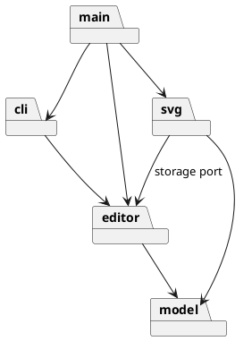

# Lab1 Phase 1：SVG 命令行编辑器

> 本文档记录课程要求的架构方案、代表性设计过程和验证依据。功能验收以仓库外的 `phase_cli_1.md` 为准；命令契约与未决问题见 [`requirements.md`](requirements.md)。

## 1. 当前阶段

需求与模块边界已确定；当前可运行切片覆盖 `init`、`canvas`、六种内置图形的 `create`、`tree`、`delete`、`move`、`scale`、`set`、`group`，以及相应的 `undo`/`redo`。其他编辑、读写及插件能力尚未完成；未明确的语义保留在 `requirements.md` 的 `AMB-*`，不作为既定需求。

## 2. 架构方案

### 2.1 模块划分

| 目录          | 职责                            | 边界                       |
| ------------- | ------------------------------- | -------------------------- |
| `src/model/`  | 画布、图形、层级、id 和几何规则 | 封装领域状态，提供只读查询 |
| `src/editor/` | 会话、Command、执行器和撤销重做 | 协调编辑，不承载图形规则   |
| `src/svg/`    | SVG/XML 解析、序列化与文件适配  | 隔离 I/O 和第三方库        |
| `src/cli/`    | 命令解析、分发及输出            | 只依赖编辑能力             |
| `src/main.ts` | 装配和 REPL 入口                | 不承载业务规则             |

读写切片启动前不创建空的 `src/svg/`。模块包图：

### 2.2 设计模式与依赖方向

题目要求的 Command 用于把一次编辑请求变成一个撤销单元：具体命令调用 `model` Receiver，只保存本次操作所需的反向信息；执行器管理历史。Composite 用于让叶子图形与 `g` 容器在适用编辑操作上共享抽象。两者的参与者与测试要求见 [`ADR-001`](adr/ADR-001-module-boundaries.md)。其他模式只在出现实际变化压力时采用。

允许 `cli → editor → model`、`svg → editor/model`，`main` 负责装配。禁止 `model` 反向依赖外围模块、`editor` 依赖具体 SVG 适配器、`cli` 直接读写领域内部状态。后续以实际 import 检查。

### 2.3 变化点与取舍

- 新图形类型：Phase 1 仅内置题目六类，集中名称分派；后续 `box` 插件才考虑注册机制。
- 输入通道与 XML 库：分别限制在 `cli` 和 `svg`，不把解析器细节传入领域对象。
- `<g transform>` 尚未明确；跨父 `group` 的位置与顺序按用户确认的 ADR-003 执行。

四模块与六模块方案的比较见 [`architecture-proposal.md`](architecture-proposal.md)；接受的边界见 [`ADR-001`](adr/ADR-001-module-boundaries.md)。

## 3. 需求追踪

`requirements.md` 使用 `REQ-*`、`INV-*`、`AC-*` 追踪功能、不变式与验收场景。`REQ-004`/`REQ-005` 的画布查询、修改和历史屏障，`REQ-020`/`AC-007` 的删除、`REQ-021`/`AC-008` 的平移、`REQ-022`/`AC-009` 的缩放、`REQ-023`/`AC-010` 的属性设置，以及 `REQ-024`/`AC-011~012` 的分组已有领域、会话与 CLI 测试；`AC-018` 仍需 `read`/`save` 才能整体验收。其他要求仍需后续切片实现。题目未展示的编辑和画布命令成功摘要属于 `AMB-012` 的可替换 CLI 表现形式，不声称是精确题目文本。

## 4. 架构决策

| 决策    | 结论                                                         | 范围                                           |
| ------- | ------------------------------------------------------------ | ---------------------------------------------- |
| ADR-001 | 采用四模块方案 A；六模块方案 B 的额外转发层暂不引入          | 目录职责与依赖方向；不覆盖未决 SVG/group 语义  |
| ADR-002 | 普通 `g` 的公共样式保存在组自身，由 SVG 继承；不递归改写子项 | `set` 的组样式语义；不覆盖后续插件专门传播规则 |
| ADR-003 | `group` 放在最近共同父级；成员按原文档顺序排列               | 普通组的放置、顺序与局部撤销信息               |

## 5. 过程记录

| 代表性讨论                    | 审查与决定                                                                                    | 证据                            |
| ----------------------------- | --------------------------------------------------------------------------------------------- | ------------------------------- |
| AI 提出四模块和六模块两种划分 | 比较变更传播与接口宽度后，用户确认四模块方案；保留 `transform` 等未决项，不把猜测写进架构约束 | 方案比较、ADR-001               |
| 对创建命令的反向信息进行审查  | 发现越序撤销非空容器可能使子节点脱离文档；在领域层拒绝该操作，并加入状态不变的回归测试        | `SvgDocument.test.ts`           |
| 普通容器的公共样式语义        | 比较原生继承与递归改写后，用户确认前者；撤销只恢复组自身属性，不触及后代显式样式              | ADR-002、`SetAttribute.test.ts` |
| 跨父分组的位置与成员顺序      | 比较最近共同父级与根级追加后，用户选择前者；成员按原文档顺序，撤销保留每个原父节点与索引      | ADR-003、`Grouping.test.ts`     |

删除操作比较了全局快照与“子树引用＋原父节点＋原位置”两种撤销表示；选择后者，并以连续撤销/重做、重复 id 和失败后状态不变的测试核查。平移审查发现仅保存反向位移会因浮点舍入无法精确恢复，故只保留受影响坐标的前后值；容器先预计算整棵子树，再统一应用。缩放同样不采用倒数因子撤销：它可能产生浮点误差或溢出；各图形只保留本次受影响几何值的前后状态，容器先预计算所有后代，确保失败时无部分改动。画布修改比较了原位更新与重建文档，选择前者以保留图形树；尺寸由文档校验，成功后由会话建立历史屏障，失败不触及历史。此前真实 REPL 输入验证还暴露了 PowerShell 管道的中文编码问题；已补齐进程级回归测试，并在仓库首页注明回放条件。只记录影响设计的关键判断与纠偏，不保存逐轮对话流水账。

## 6. 质量保证

每个能力先明确成功、失败和状态语义，再以领域、命令历史、CLI 和跨模块测试验证。本切片通过类型、Lint、格式、依赖方向检查与 75 项自动化测试；当前已实现源码的语句覆盖率为 95.94%，不代表整份题目覆盖率。完整 transcript 与 SVG 往返测试留作后续验收门禁；目前尚不能声称 Phase 1 功能完整。

## 7. 一致性自查

- 模块划分：`model`、`editor`、`cli` 与装配入口已落地；`svg` 待读写切片实现，无空业务模块。
- 依赖方向：`npm run deps:check` 已检查当前 94 条本地 import，均符合依赖规则；后续每组能力继续复查。

## 8. Git 约定

以需求、架构和可运行能力为合理粒度，采用英文类型前缀加准确中文描述，例如 `feat: 实现基础编辑与撤销重做`。测试与其实现可以属于同一能力提交；不为日常过程说明单独拆分提交。交付前检查暂存文件，完成全部交付检查后再创建题目要求的 `final` 标签。
