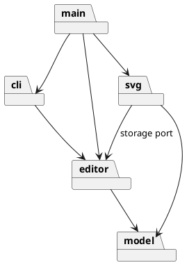

# Lab1 Phase 1：SVG 命令行编辑器

> 本文档记录课程要求的架构方案、代表性设计过程和验证依据。功能验收以仓库外的 `phase_cli_1.md` 为准；命令契约与未决问题见 [`requirements.md`](requirements.md)。

## 1. 当前阶段

需求与模块边界已确定；当前可运行切片覆盖 `init`、六种内置图形的 `create`、`tree` 和创建操作的 `undo`/`redo`。其他编辑、读写及插件能力尚未完成；未明确的语义保留在 `requirements.md` 的 `AMB-*`，不作为既定需求。

## 2. 架构方案

### 2.1 模块划分

| 目录          | 职责                            | 边界                       |
| ------------- | ------------------------------- | -------------------------- |
| `src/model/`  | 画布、图形、层级、id 和几何规则 | 封装领域状态，提供只读查询 |
| `src/editor/` | 会话、Command、执行器和撤销重做 | 协调编辑，不承载图形规则   |
| `src/svg/`    | SVG/XML 解析、序列化与文件适配  | 隔离 I/O 和第三方库        |
| `src/cli/`    | 命令解析、分发及输出            | 只依赖编辑能力             |
| `src/main.ts` | 装配和 REPL 入口                | 不承载业务规则             |

读写切片启动前不创建空的 `src/svg/`。模块包图：

### 2.2 设计模式与依赖方向

题目要求的 Command 用于把一次编辑请求变成一个撤销单元：具体命令调用 `model` Receiver，只保存本次操作所需的反向信息；执行器管理历史。Composite 用于让叶子图形与 `g` 容器在适用编辑操作上共享抽象。两者的参与者与测试要求见 [`ADR-001`](adr/ADR-001-module-boundaries.md)。其他模式只在出现实际变化压力时采用。

允许 `cli → editor → model`、`svg → editor/model`，`main` 负责装配。禁止 `model` 反向依赖外围模块、`editor` 依赖具体 SVG 适配器、`cli` 直接读写领域内部状态。后续以实际 import 检查。

### 2.3 变化点与取舍

- 新图形类型：Phase 1 仅内置题目六类，集中名称分派；后续 `box` 插件才考虑注册机制。
- 输入通道与 XML 库：分别限制在 `cli` 和 `svg`，不把解析器细节传入领域对象。
- `<g transform>`、跨父 `group` 的位置语义尚未明确，不提前冻结实现策略。

四模块与六模块方案的比较见 [`architecture-proposal.md`](architecture-proposal.md)；接受的边界见 [`ADR-001`](adr/ADR-001-module-boundaries.md)。

## 3. 需求追踪

`requirements.md` 使用 `REQ-*`、`INV-*`、`AC-*` 追踪功能、不变式与验收场景。当前切片的六种图形创建、层级查询、创建历史及 REPL 文本输入已有领域、会话与 CLI 测试；其他要求仍需后续切片实现。

## 4. 架构决策

| 决策    | 结论                                                | 范围                                          |
| ------- | --------------------------------------------------- | --------------------------------------------- |
| ADR-001 | 采用四模块方案 A；六模块方案 B 的额外转发层暂不引入 | 目录职责与依赖方向；不覆盖未决 SVG/group 语义 |

## 5. 过程记录

| 代表性讨论                    | 审查与决定                                                                                    | 证据                  |
| ----------------------------- | --------------------------------------------------------------------------------------------- | --------------------- |
| AI 提出四模块和六模块两种划分 | 比较变更传播与接口宽度后，用户确认四模块方案；保留 `transform` 等未决项，不把猜测写进架构约束 | 方案比较、ADR-001     |
| 对创建命令的反向信息进行审查  | 发现越序撤销非空容器可能使子节点脱离文档；在领域层拒绝该操作，并加入状态不变的回归测试        | `SvgDocument.test.ts` |

一次真实 REPL 输入验证还暴露了 PowerShell 管道的中文编码问题；补齐进程级回归测试，并在仓库首页注明回放条件。只记录影响设计的关键判断与纠偏，不保存逐轮对话流水账。

## 6. 质量保证

每个能力先明确成功、失败和状态语义，再以领域、命令历史、CLI 和跨模块测试验证。本切片通过类型、Lint、格式、依赖方向、跟踪文件检查与 22 项自动化测试；当前已实现源码的语句覆盖率为 94.9%，不代表整份题目覆盖率。完整 transcript 与 SVG 往返测试留作后续验收门禁；目前尚不能声称 Phase 1 功能完整。

## 7. 一致性自查

- 模块划分：`model`、`editor`、`cli` 与装配入口已落地；`svg` 待读写切片实现，无空业务模块。
- 依赖方向：`npm run deps:check` 已检查当前 48 条本地 import，均符合依赖规则；后续每组能力继续复查。

## 8. Git 约定

以需求、架构和可运行能力为合理粒度，采用英文类型前缀加准确中文描述，例如 `feat: 实现基础编辑与撤销重做`。测试与其实现可以属于同一能力提交；不为日常过程说明单独拆分提交。交付前检查暂存文件，完成全部交付检查后再创建题目要求的 `final` 标签。
