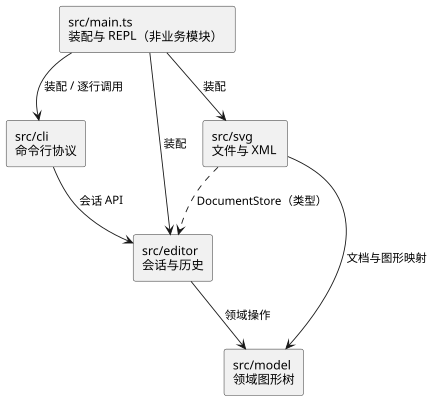

# ADR-001：模块边界与依赖方向

- 状态：已接受（仅限模块职责与依赖方向）
- 决定日期：2026-10-21
- 适用范围：Phase 1 的目录级架构；普通组样式、分组顺序与 SVG 读写分别由 [ADR-002](ADR-002-group-style-semantics.md)、[ADR-003](ADR-003-group-placement.md) 和 [ADR-004](ADR-004-svg-io-scope.md) 确定。

## 问题与评价依据

Phase 1 需要实现可撤销编辑、嵌套图形、CLI 交互与 SVG 读写。模块划分应让图形规则、编辑历史、文件格式和文本协议各有明确归属，同时控制跨模块接口数量，并允许各部分独立测试。比较时重点考察新增编辑操作的改动范围、依赖方向及后续扩展的成本。`box` 插件属于后续阶段，不作为本阶段增加空模块或注册接口的理由。

## 候选方案与取舍

| 比较项     | 方案 A：四个业务模块                                                                        | 方案 B：拆分编辑内部职责                                                    |
| ---------- | ------------------------------------------------------------------------------------------- | --------------------------------------------------------------------------- |
| 目录       | `model`、`editor`、`svg`、`cli`；`main.ts` 负责装配                                         | `model`、`session`、`commands`、`history`、`svg`、`cli`；`main.ts` 负责装配 |
| 规则归属   | `model` 管理图形树；`editor` 封装会话、命令与历史；`svg` 管理文件和 XML；`cli` 管理文本协议 | 图形、文件与 CLI 边界相同；将 `editor` 内部三项职责分别设为模块             |
| 协作成本   | 命令与执行器在 `editor` 内协作，对外仅暴露会话及存储端口                                    | 会话、命令和历史之间需要维护更多跨目录契约                                  |
| 测试与风险 | 领域、历史、持久化和 CLI 均可独立测试；须防止 `editor` 的公开接口持续扩大                   | 各目录可独立测试；没有历史能力的独立复用需求时，新增模块可能仅转发调用      |

## 决定

采用方案 A。命令执行、历史栈和 I/O 屏障共同维护一次编辑的生命周期，置于 `editor` 内可隐藏其协作细节；图形校验和树操作仍由 `model` 完成。方案 B 可以实现相同行为，但本阶段没有独立复用历史的需求，新增的跨目录接口尚无相应收益。各模块职责与允许的源码依赖如下：

| 目录          | 拥有的规则                                                        | 允许依赖                             |
| ------------- | ----------------------------------------------------------------- | ------------------------------------ |
| `src/model/`  | 图形、容器、画布、id、几何和树结构业务规则                        | 标准库与纯工具                       |
| `src/editor/` | 会话、编辑 Command、Invoker、撤销重做和文档生命周期；定义存储端口 | `model`                              |
| `src/svg/`    | SVG/XML 与文件系统适配，读取警告和序列化                          | `model`、`editor` 的存储端口、选定库 |
| `src/cli/`    | 单行命令解析、唯一命令名分发与文本格式                            | `editor` 的公开 API                  |
| `src/main.ts` | 组合根及进程入口，装配模块并管理 REPL 输入流、横幅和提示符        | 上述模块                             |

规则：`model` 不导入外围模块；`editor` 不导入 `cli` 或 `svg` 的具体实现；`svg` 不修改编辑历史；`cli` 不读取或改变 model 内部可变状态。`src/main.ts` 只负责对象装配与进程 I/O，不承载命令解析或业务校验。允许 `svg` 对 `editor` 存储端口使用类型依赖，反向的具体实现依赖禁止。

图源：[PlantUML 组件图](../assets/architecture.plantuml)。

Command 的 Client 是构造具体命令的 `EditorSession`，Invoker 是 `CommandExecutor`；ConcreteCommand 绑定请求与 `SvgDocument` Receiver 并持有不透明回执，反向数据由 Receiver 私有保存。Composite 使普通图形与 `g` 在适用操作上统一。Adapter 在文件/XML 能力与客户端的文档存储接口不一致处使用，具体边界见 ADR-004。

## 理由与代价

四模块方案保留了领域、历史、持久化和 CLI 的独立测试边界。其主要风险是 `editor` 容纳多个紧密相关的类；通过收敛公开接口、区分内部职责和检查实际导入控制其复杂度。

## 验证与演化

- 实际源码按 `model`、`editor`、`svg`、`cli` 划分；`npm run deps:check` 同时验证目录方向、存储端口的类型依赖及外部 API 的使用边界。
- 领域、命令历史、SVG 适配器和 CLI 各有独立测试；Command 参与者和业务 Receiver 的协作由编辑测试验证。
- 命令分发和图形工厂是本阶段集中按名字分派的两处；新增插件或命令注册机制时再评估重构。Phase 1 不实现 `box` 插件。

## 复议条件

若实际代码出现跨模块读取内部树或历史、多个外层模块复制同一规则、CLI 替换迫使修改 `model`，或 `editor` 同时承受互不相关的频繁变化，应重新比较模块边界。若历史执行能力出现独立复用需求，也可复议是否拆分会话、命令和历史。调整后同步修订本 ADR、组件图和导入规则，并核对源码。
