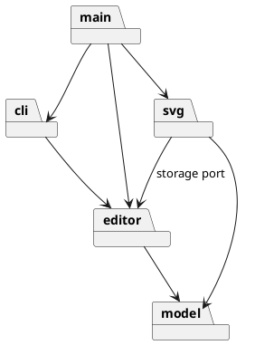

# ADR-001：Phase 1 模块边界

- 状态：已接受（仅限模块职责与依赖方向）
- 决定日期：2026-10-21
- 确认来源：用户明确同意 `doc/architecture-proposal.md` 的方案 A，并要求开展下一步工作。
- 适用范围：Phase 1 的目录级架构；尚未决定的命令细节和外部 SVG 语义继续按 `requirements.md` 的 `AMB-*` 管理。

## 背景与候选

题目要求可撤销编辑、嵌套 SVG 图形、CLI 交互和 SVG 读写，也要求真实的 Command 协作、面向对象和可核查的依赖规则。候选 A 使用四个有独立知识边界的模块；候选 B 把会话、命令和历史进一步拆成三个模块。完整比较见 [`architecture-proposal.md`](../architecture-proposal.md) §3。

## 决定

采用候选 A：

| 目录          | 拥有的规则                                                        | 允许依赖                             |
| ------------- | ----------------------------------------------------------------- | ------------------------------------ |
| `src/model/`  | 图形、容器、画布、id、几何和树结构业务规则                        | 标准库与纯工具                       |
| `src/editor/` | 会话、编辑 Command、Invoker、撤销重做和文档生命周期；定义存储端口 | `model`                              |
| `src/svg/`    | SVG/XML 与文件系统适配，读取警告和序列化                          | `model`、`editor` 的存储端口、选定库 |
| `src/cli/`    | REPL、命令行解析与唯一命令名分发、文本格式                        | `editor` 的公开 API                  |
| `src/main.ts` | 组合根，构造并连接各模块                                          | 上述模块                             |

规则：`model` 不导入外围模块；`editor` 不导入 `cli` 或 `svg` 的具体实现；`svg` 不修改编辑历史；`cli` 不读取或改变 model 内部可变状态。`src/main.ts` 只装配对象。允许 `svg` 对 `editor` 存储端口使用类型依赖，反向的具体实现依赖禁止。

Command 的 Client 是会话/命令装配处，Invoker 是统一执行器，ConcreteCommand 只绑定请求与 Receiver 并保留本次恢复信息，Receiver 是 model 中的领域对象。Composite 使普通图形与 `g` 在适用操作上统一。Adapter 只在选定 XML/文件库确实与客户端存储接口不一致时使用。

## 理由与代价

候选 A 将几何、历史、文件格式和交互协议分别收进边界清晰的模块。候选 B 也可实现，但当前没有单独复用历史的需求；额外的跨目录接口容易形成仅转发调用的浅层。候选 A 的风险是 `editor` 逐渐变大，因此用清晰的内部类职责、窄公开 API 和导入审查控制；若出现互不相关的变化或第二个入口需要独立复用历史，再重新比较拆分。

## 验证与演化

- 首个切片用 model、editor、cli 三层的独立测试和 CLI 回放证明依赖方向、业务 Receiver 和 Command 协作；尚未使用的 `svg` 模块不建立空目录或占位类。
- 后续每个切片运行类型、lint、格式、单元与集成测试，并抽查真实 import 对照本 ADR。
- 题目只允许命令分发和图形工厂两处按名字分派；这两处列为后续迭代的可重构点。Phase 1 不实现 `box` 插件。
- `AMB-006`（group 放置）与 `AMB-010`（读入 transform）等仍未确定，不因本 ADR 自动获得新行为。首个切片不依赖它们；涉及这些行为前，另记具体决策和测试。

## 复议条件

若实际代码出现跨模块读取内部树/历史、多个外层模块复制同一规则、CLI 替换迫使修改 model，或 `editor` 同时承受互不相关的频繁变化，则先更新 ADR 再重构。不能只修改图而不检查 import。
