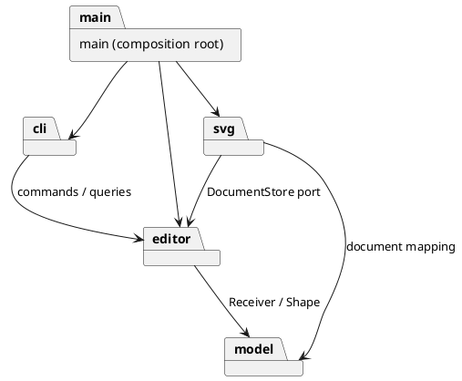

# Phase 1 架构讨论稿

> 状态：本文保留实施前的方案比较与当时的待决事项；已接受的模块边界见 [`ADR-001`](adr/ADR-001-module-boundaries.md)，当前实现、测试与后续语义决定以 [`README.md`](README.md) 和相关 ADR 为准。
>
> 原始目标：在实现前为 [需求契约](requirements.md)比较模块边界、依赖方向和模式协作。本文件保留方案比较，已落地的决定以 ADR 和第 9 节为准。

## 1. 已确定的设计输入

| 类别     | 已确定事实                                                                                | 证据                                           |
| -------- | ----------------------------------------------------------------------------------------- | ---------------------------------------------- |
| 功能     | 六种图形、嵌套 `g`、编辑/显示/文档命令、SVG 读写与精确 CLI 输出                           | `../../phase_cli_1.md` §2–6；`requirements.md` |
| 历史     | 一条编辑命令一个撤销单元；显示跳过历史；I/O 和画布修改形成屏障；失败不改变任何状态        | 题目 §2、§4.3；`INV-002`、`INV-006`            |
| 范式     | TypeScript 面向对象；类层次、多态、封装、一类一文件；只有命令分发和图形工厂允许按名字分派 | 题目 §2.1；`QUAL-001`–`003`                    |
| 模式     | Command 必须落地；叶子和容器必须有 Composite 语义                                         | 题目 §1.2、§2.1；`PPT/command.pdf`             |
| 交付     | 模块职责和 PlantUML 图、模式协作、依赖规则、变化点、过程记录、一致性自查、质量证据        | 题目 §1；`QUAL-005`–`007`                      |
| 阶段边界 | `box` 与插件恢复是后续阶段目标；Phase 1 遇到 `create box` 返回未知类型                    | 题目 §4.4、§6.1；`AC-023`                      |

课堂 `note.md` 要求先建立业务行为，再叠加 Command；用迭代中的改动范围检验架构；通过真实代码导入检查文档中的依赖图。课程 `PPT/tdd.pdf` 把单元测试、跨模块集成测试和需求验收分别对应详细设计、架构和需求。历史评分资料仅作审查视角，不覆盖当前题目。

## 2. 变化点与投入边界

| 变化                          | 确信程度 / 影响                           | 现在保留的能力                                     | 暂不投入的能力                                                                    |
| ----------------------------- | ----------------------------------------- | -------------------------------------------------- | --------------------------------------------------------------------------------- |
| 后续引入 `box` 复合图形及插件 | 高 / 高：题目已展示后续语义               | 形状多态、图形工厂集中、树结构与 XML 细节隔离      | Phase 1 不做插件注册框架、`data-kind` 或 `box` 内部结构                           |
| 另一个交互入口（GUI/agent）   | 中 / 中：题目 §2 提及多通道 id 定位       | 业务与 CLI 解析/格式化分开；入口调用同一编辑执行器 | 不建事件总线、Observer 或多端协议                                                 |
| SVG 解析器或保存方式变化      | 中 / 中：第三方库与文件 API 可能调整      | 把 XML/文件系统知识限制在一个适配模块              | 不承诺完整 SVG/CSS 标准兼容                                                       |
| 新增图形属性与显示格式        | 中 / 中                                   | 形状维护自身几何规则，输出由只读投影供 CLI 格式化  | 不因猜测增加通用属性系统或 Visitor                                                |
| 外部 SVG 的 `transform`       | 未知 / 高：题目背景有示例，命令细则无定义 | 解析入口和领域几何保持独立                         | 已决定严格读入明确支持的子集，超出子集则整条 read 失败；见 `AMB-010` 与 `ADR-004` |

## 3. 两个候选方案

| 维度                | A：四个有明确知识边界的模块（推荐讨论）                                                         | B：将会话、命令、历史拆成独立模块                                                           |
| ------------------- | ----------------------------------------------------------------------------------------------- | ------------------------------------------------------------------------------------------- |
| 未来目录            | `src/model`、`src/editor`、`src/svg`、`src/cli`，加 `src/main.ts` 装配                          | `src/model`、`src/commands`、`src/history`、`src/session`、`src/svg`、`src/cli`，加装配入口 |
| 规则归属            | 几何、层级和 id 在 model；具体命令、执行器、会话与历史在 editor；XML/文件在 svg；文本协议在 cli | model 与 A 相同；ConcreteCommand、历史执行器、文档会话分别独立                              |
| 依赖方向            | `cli → editor → model`；`svg → editor` 的读写端口与 `model`；装配入口连接各方                   | `cli → session → history → commands → model`；`session → svg` 的端口；svg 依赖端口与 model  |
| 模块凝聚 / 接口宽度 | `editor` 内部有多类，但公开的是编辑、查询与文档生命周期能力；可隐藏历史实现                     | 单模块更小、历史可独立复用；跨目录接口更多，执行一次编辑需要理解多层协作                    |
| 可测试性            | model、具体命令、执行器、文件适配器、CLI 均可分别测试；同一目录不妨碍独立测试                   | 测试接缝更多，但也要为每层维护契约与测试替身                                                |
| 单项需求的改动半径  | 改几何通常只动 model 和对应测试；改 CLI 输出只动 cli；改历史规则只动 editor                     | 对应责任也可局部修改；跨 session/history/commands 的协议变更更容易连锁修改                  |
| 新 `box` 的预计改动 | 新图形及集中工厂、读回识别、形状自身投影；仍需在后续插件阶段改造工厂为注册点                    | 与 A 相同，额外可能触及 commands/session 的类型或请求协议                                   |
| 成本 / 主要风险     | `editor` 可能长成上帝模块，需以内部文件职责和公开 API 控制                                      | 容易形成只转发参数的 `session → history → command` 浅层接口；提前做跨模块抽象               |

两者都能满足题目。A 的取舍是以更少的公开边界承载较深的能力；只有当历史确实被第二种入口单独复用，或 `editor` 内出现多处相互无关的变化时，才把它拆成 B 的独立模块。这里的“更少模块”不是压平文件：每个具体类仍单独成文件，`editor` 内部可以按命令、历史和会话组织文件。此判断采用 `software-design-philosophy` 技能对深模块、信息隐藏、改动放大和转发层的审查准则。

## 4. 候选 A 的模块地图与依赖规则

方案 A 的目录边界现已接受；本节中具体类名与方法仍是待测试验证的草案。

| 未来目录      | 拥有的知识                                                                                   | 对外契约草案                                                                                  | 允许依赖                                  | 禁止依赖及原因                                                       |
| ------------- | -------------------------------------------------------------------------------------------- | --------------------------------------------------------------------------------------------- | ----------------------------------------- | -------------------------------------------------------------------- |
| `src/model/`  | 画布、id 索引、六种图形、父子顺序、几何与结构编辑的校验和原子变化                            | `SvgDocument` 的明确业务方法；`Shape` 的多态操作与只读投影；操作返回最小恢复凭据              | 标准 TypeScript/必要纯工具                | cli/editor/svg、文件系统、第三方 XML；业务规则不能被外围技术反向牵引 |
| `src/editor/` | 会话当前文档、默认读入路径、ConcreteCommand、统一执行器、undo/redo 与 I/O 屏障；定义读写端口 | 构造命令所需的 Receiver、执行/撤销/重做、查询、init/read/save/canvas；端口只表达载入/保存文档 | model、模块自有端口                       | cli、真实文件系统、XML 库；不输出带 `svg>`/`error:` 的文本           |
| `src/svg/`    | SVG/XML 映射、文本转义、外部文件读写、缺 id 警告；实现 editor 所定义端口                     | `SvgFileStore` 一类适配器；载入完整文档或报告失败；保存成功后才返回                           | model、editor 的读写端口、选定 XML/文件库 | cli、命令历史；读写库对象不得泄漏进 model/editor                     |
| `src/cli/`    | 引号/注释解析、命令名分发、错误/警告/树/明细/摘要格式                                        | 输入一行、输出规定文本的可测试入口                                                            | editor 的公开 API                         | model 内部节点、XML 库；不直接变更文档树或历史栈                     |
| `src/main.ts` | 装配具体文件适配器、会话和 CLI；管理 REPL 输入流、横幅与提示符                               | 进程入口                                                                                      | 上述模块                                  | 不承载命令解析和业务校验                                             |

建议用 PlantUML 包图表达并在实现后用导入审计核对：

`svg → editor` 仅指实现端口时对端口类型的依赖；`editor` 不导入 `svg`。允许的跨目录导入将在实施后由脚本或 lint 规则检查，不能仅靠图自称符合。

### 4.1 关键接口边界草案

- `SvgDocument` 对外提供按 id 操作和只读查询，如创建、移动、缩放、设置属性、重排和删改层级；它自己校验 id、父子关系和几何约束，并在成功后返回关联局部反向数据的回执。接口不暴露可写子节点数组或 id Map。
- `Shape`/`GroupShape` 承担适用的移动、缩放、属性处理与只读描述；容器递归应用操作。具体形状自身掌握几何字段，避免命令或 SVG 适配器遍布类型分支。
- `EditCommand` 表达一次请求，持有 Receiver 和执行后取得的最小凭据；`CommandExecutor` 统一执行、管理两个历史栈和屏障。业务校验与子树操作位于 Receiver/形状，不写进命令。
- `DocumentStore` 以客户端需要的文档载入/保存能力定义，供真实 SVG 文件实现和测试替身实现。解析器 DOM、文件句柄与错误对象不得穿过端口。
- CLI 只产生请求、接收结构化结果并格式化规定文本。tree/show 使用脱离活节点的只读投影，保留各形状的属性顺序和信息，不成为可写“公共数据袋”；相应行为已有模型与 CLI 测试。

## 5. 模式协作与代价

| 模式或机制                       | 实际问题与参与者                                                                                                                                                                  | 运行协作及验证                                                                                                                                                                                         | 代价 / 更简单方案的取舍                                                                                              |
| -------------------------------- | --------------------------------------------------------------------------------------------------------------------------------------------------------------------------------- | ------------------------------------------------------------------------------------------------------------------------------------------------------------------------------------------------------ | -------------------------------------------------------------------------------------------------------------------- |
| Command（必选）                  | 请求需要统一执行并撤销；Client 为 `EditorSession`，Invoker 为 `CommandExecutor`，ConcreteCommand 对应编辑动作，Receiver 为 `SvgDocument`/形状领域对象                             | CLI 调会话 → 会话创建具体命令 → Invoker 执行 → 命令调用 Receiver 并保存不透明回执；Receiver 私有保存最小反向数据。撤销时命令持回执调用 Receiver。测试命令没有私自修改树，且一条 group 只占一个历史单元 | 每种编辑可能新增一个类；直接在 CLI 调业务方法类数少，但历史与入口耦合，不满足课程要求                                |
| Composite（必选语义）            | `g` 与叶子都能被定位、移动、缩放、删除；Component 为形状抽象，Composite 为组，Leaf 为五种叶子                                                                                     | `move node2` 对组调用一次，组递归子节点；用嵌套流程图和 undo 测试验证文字与矩形同动                                                                                                                    | 抽象层需保持小；不应把只有容器才支持的添子方法硬塞给所有叶子                                                         |
| Adapter（有真实库边界时采用）    | editor 的文档读写契约与文件/XML API 不同；Client 为 `EditorSession`，Target 为 `DocumentStore`，Adapter 为 `SvgFileStore`，被适配能力为 Node 文件 API 与 `SvgCodec` 封装的 XML 库 | `main` 将适配器注入会话；适配器以文件文本与 `SvgCodec` 转换文档、元素数和补 id 信息。会话用 `FakeStore` 验证失败屏障，编解码与真实临时文件分别测试；当前没有注入 Node 文件 API                         | `SvgFileStore` 隐藏文件细节，但不能用文件 API 替身精确模拟底层故障；出现独立后端或必要的故障注入需求时再比较文件端口 |
| 集中图形工厂（非额外模式得分点） | CLI 创建和 SVG 读回都需要把名称映射到类；题目允许这处按名字分派                                                                                                                   | 仅工厂识别六种类型；后续插件阶段评估注册式工厂                                                                                                                                                         | 当前有一个集中修改点；Phase 1 不提前实现插件系统                                                                     |

Visitor、Observer、Decorator、Iterator 均缺少当前 Phase 1 的充分变化压力。尤其 Visitor 需要随新增图形同步修改每个访问者，不适合把已预告的 `box` 当成主要变化时提前采用。`awesome-design-patterns` 只用于定位原始案例；[Java Command](https://github.com/iluwatar/java-design-patterns/blob/master/command/README.md)、[Composite](https://github.com/iluwatar/java-design-patterns/blob/master/composite/README.md)和 [Adapter](https://github.com/iluwatar/java-design-patterns/blob/master/adapter/README.md)案例可核对意图与参与者，但不能照搬其语言或撤销实现。课堂 Adapter 案例强调由客户端定义 Target，并从装配入口提供实际适配器以便客户端注入替身：本项目的 `EditorSession` 满足这一点；适配器内部的 Node 文件 API 未注入，不把两级替换能力混为一谈。[TypeScript 模式示例库](https://github.com/torokmark/design_patterns_in_typescript)仍以 ES5 为目标，适合作参与者草图，不适合作严格 TypeScript 项目模板。

## 6. 四条跨模块路径

1. **成功编辑**：CLI 解析命令名并调用会话；会话选择具体编辑命令；Invoker 执行；Receiver 先完整校验，后原子修改并私有保存最小反向数据；命令保存不透明回执；Invoker 成功后才入 undo 栈、清空 redo；CLI 格式化摘要。
2. **失败编辑**：Receiver 在任何可见修改前报告业务错误；Invoker 不改变历史；CLI 将其转成单行 `error:`。校验顺序必须在测试中覆盖重复 id、错误父节点与祖孙成环。
3. **undo/redo**：Invoker 检查屏障和栈；命令用回执调用 Receiver 恢复；恢复成功后才把命令移至另一栈。Receiver 私有的反向数据按操作保存原父/索引或必要几何值，不保存整份文档。
4. **read/save**：CLI 调会话；会话经 `DocumentStore` 端口访问 SVG 适配器。read 先构造完整临时文档和警告，成功后才替换当前文档；save 在文件写入成功后才设置屏障。`init/read/save/canvas` 的屏障与路径属于会话，XML 不应操作历史。

## 7. 测试架构与证据

| 测试层         | 独立输入与可观察输出                                                                                                                                    | 对应验收                     |
| -------------- | ------------------------------------------------------------------------------------------------------------------------------------------------------- | ---------------------------- |
| model          | 直接创建文档和形状，断言几何、父子关系、id 唯一及失败原子性                                                                                             | `AC-004`–`015`、`AC-019`     |
| 命令与 Invoker | 使用真实 `SvgDocument`，断言命令委托、回执复用、undo/redo 粒度和屏障；反向数据由 Receiver 私有保存                                                      | `AC-007`–`018`               |
| SVG 适配器     | `SvgCodec` 验证元素数、补 id 和转义；`SvgFileStore` 用真实临时目录验证往返与保存失败；`EditorSession` 注入 `DocumentStore` 替身验证读写失败后的会话状态 | `AC-020`、`AC-024`           |
| CLI            | 使用真实 `EditorSession`；纯命令测试无需磁盘，文件命令测试使用真实临时文件，断言引号、注释、错误和格式                                                  | `AC-001`、`AC-016`、`AC-023` |
| 完整会话       | 回放题目两段黄金 transcript，核对所有已指定输出和生成 SVG                                                                                               | `AC-021`、`AC-022`           |

实施前曾建议以 `init`、`create g`、`create rect ... in g`、`tree` 为首个闭环，再补 `move g` 与 undo；这些能力现已实现。保留该记录用于说明先以纵向切片验证树、Composite、CLI 输出与历史协作的思路，不作为当前待办。

## 8. 演进演练

| 变化          | 候选 A 预计改动                                                                                                 | 对核心的影响 / 真实性约束                                                                                                             |
| ------------- | --------------------------------------------------------------------------------------------------------------- | ------------------------------------------------------------------------------------------------------------------------------------- |
| 后续 `box`    | 预计 2–3 个既有模块：model 新复合形状与集中工厂；svg 识别 `data-kind` 并处理降级；CLI help 可能更新；另加新测试 | Phase 1 的工厂仍会修改，故不能声称“内核零改动”。后续插件阶段需先把集中工厂演进成注册点，再验证新增插件不改内核；不得在 Phase 1 偷实现 |
| 换 XML 解析库 | 预计 1 个既有模块：`src/svg/` 与该模块测试                                                                      | model/editor 接口不暴露 DOM，预期无需改；用 round-trip 契约回归证明                                                                   |
| 新增 GUI 入口 | 预计 1 个既有文件 `src/main.ts`：再增加 GUI 模块并完成装配，复用 editor 的命令与查询能力                        | 只有当 editor API 含 CLI 专用字符串时才会外溢，因此现在要避免该耦合                                                                   |
| tree 格式调整 | 预计 1–2 个既有模块：cli 格式化与输出测试；如当前投影不足，再调整 model 的只读投影                              | 不保证“永远只改 CLI”；投影是否足够需先用六种形状测试验证                                                                              |

## 9. 实施后决策状态

| 事项                           | 当前状态与证据                                                                                                |
| ------------------------------ | ------------------------------------------------------------------------------------------------------------- |
| 模块方案                       | 已采用 A 的四模块职责与依赖方向；见 `ADR-001`。B 仍是条件性候选，不是待决实施项。                             |
| 只读形状投影                   | 已由形状提供有序只读展示数据，CLI 负责树线与文本排版；以六种形状的显示测试和导入审计核查。                    |
| `AMB-006` group 放置与跨父顺序 | 已按 `ADR-003` 明确并用结构编辑测试覆盖。                                                                     |
| `AMB-010` 外部 SVG             | 已按 `ADR-004` 严格读入明确支持的子集；题目背景示例中的额外内容不属于当前实现范围，超出子集整条 `read` 失败。 |
| `AMB-004` 默认保存路径         | 已由会话持有，具体显式/无参保存与失败行为见 `requirements.md` 和会话测试。                                    |
| `AMB-007` front/back           | 已按 SVG 绘制顺序解释，并以重排及保存测试覆盖；其课程术语歧义仍在 `requirements.md` 标明。                    |
| 其余题目歧义                   | 以 `requirements.md` 的 AMB 清单为准；尚无教师确认的事项不伪装为题目原文。                                    |

此表区分已实现的项目决策与题目原生要求。模式参与者及实现边界以实际代码和 `ADR-001`、`ADR-004` 为准。
